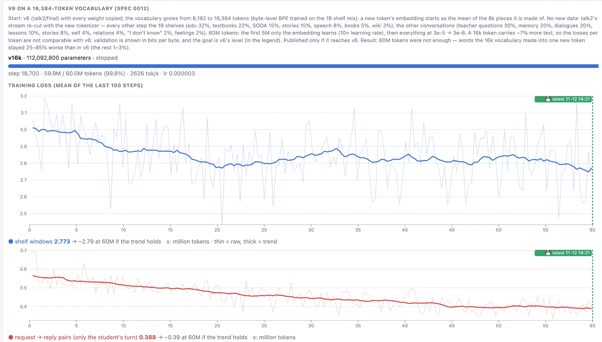
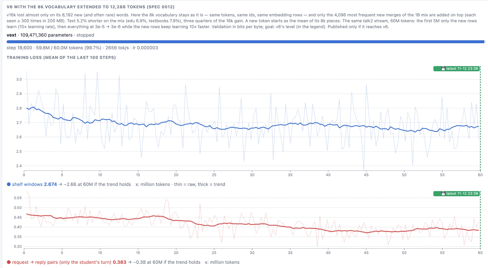
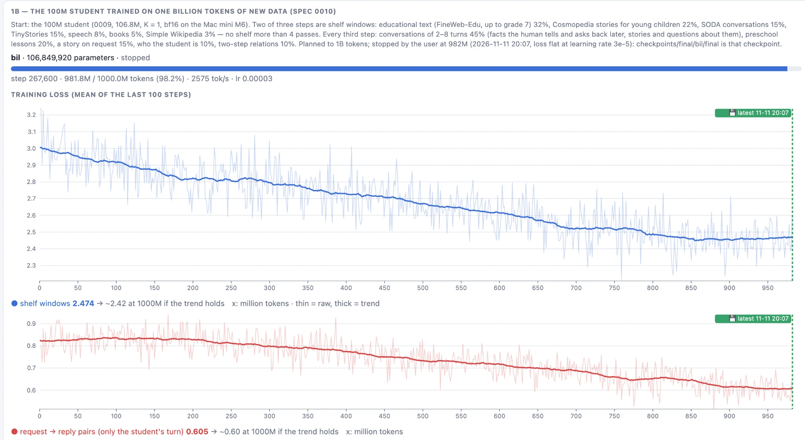
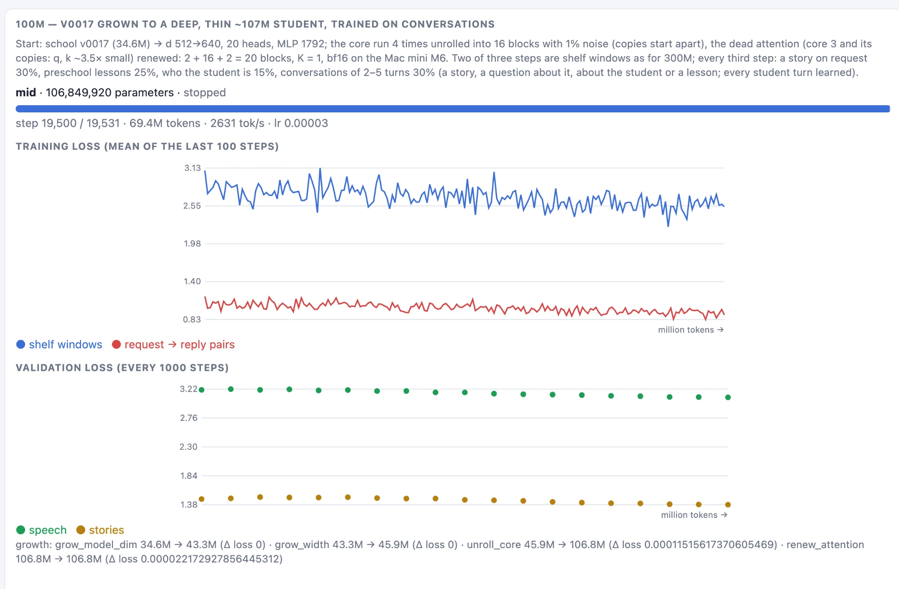

# Changelog

What has actually been delivered, by date (newest first). Intent of changes: `specs/`. Proof: tests.

## 2026-11-23 — a larger student grown from v20, with a loop in its core

[0021](specs/0021-big-student.md): `facts3` (more fact pairs, 160k → 203k, and continued tuning) left knowledge at
106–122 of 280; pass@8 of v20 (661, knowledge 156) and a coverage check (84 of the 120 never-answered knowledge
questions have no pair with their answer) point to missing data, not a missing form.

- `scripts/qa/lead_passages.py`: 40,000 basic-fact passages, the openings of the Simple Wikipedia articles mentioned most
  by others; pairs generated from them and merged (397,527 pairs in all).
- `final_test.py grow big`: v20 → 287.7M function-preservingly (Δ loss ≤ 2.4e-7); new blocks copy core blocks 8–15 with
  outputs zeroed and new readers at std 0.003 (fresh blocks made the loss jump from 3.08 to 4.5).
- `StudentConfig.n_loop`: only the last core blocks loop (`big`: 8 blocks, K 1–3 in training, 2 in evaluation);
  `bench1000.py`/`passk.py` take `BENCH_K`, `to_llama.py` writes the loop out unrolled.
- `scripts/hf/passk.py`: pass@1 against pass@K on bench1000.
- DiLoCo run `big` started (3B tokens, three cards, ~10k tokens/s); the panel has a tab for it.

## 2026-11-22 — v20: tuned on fact questions

[0020](specs/0020-fact-questions.md): `bil10/final` tuned on 145k teacher-written fact questions from its own shelves.
`facts2` (every other step on the shelves) scores **547** of 1000 on bench1000 (`v15-12488M` 503) and **120** of 280 on
knowledge (69); shelf validation +0.04–0.07. Published as **`v20-12538M`** in the model repo and as the chat Space's
default (v20, v15, v6). `facts` (3 of 4 steps on questions) reached 525 / 117 but forgot +0.11–0.22 of the shelves.

- `scripts/qa/generate.py`: `--pause` and `--cool` rest a hot card after each chunk; generation of more pairs resumed.

## 2026-11-21 — a voice panel: the admin talks to Cerbeto

[0019](specs/0019-voice-chat-panel.md): **`uv run cerbeto serve`** loads a student once and serves, on `127.0.0.1:8766`
only, a small API (`/v1/health`, `/v1/reply`, `/v1/reset`) and a voice panel. The admin speaks, local Whisper writes it
down, the student answers, the answer appears as text and local Piper reads it aloud at once. How to start it and what
to install: [docs/voice-panel.md](docs/voice-panel.md).

- **Reused from Agentaro's voice mode:** the same `whisper-cli`, Whisper weights, Piper and voices (found in
  `../agentaro/storage/voice`, or set by Agentaro's own environment variables), the same Whisper arguments and the
  clean-up of invented subtitle sentences; in the browser its microphone handling, silence detection, WAV encoding and
  sentence-ordered playback. The spec placed the panel in Agentaro; that repository was not reachable from here, so the
  panel lives in Cerbeto and `/v1/*` stays the contract for an Agentaro view later.
- **Panel:** the conversation as text, a mic button (Space) with *Done*, states *Offline* (with the start command;
  comes back by itself) · *Ready* · *Listening* · *Thinking* · *Speaking* (the sentence read is marked; *Stop* / Esc) ·
  *Problem* (*Try again*), typing always works, hands-free and memory switches. The student's thought is shown dimmed,
  never spoken. Per turn: STT time, model time, time to the first sound.
- **Server:** one lock (a second question while answering → 409, no queue), history per conversation in memory,
  `--checkpoint` for a folder anywhere (e.g. the Hugging Face download), Host / Origin checked so no other web page can
  use it, only counts and timings in its log.
- **Faster replies:** the server uses `Talker`'s token-by-token path, which stops at `<|eos|>`; `model.generate` always
  ran 60 tokens. v6 on CPU: **0.26–0.67 s** per short answer (median 0.46 s over 10 questions) instead of ~3.4 s.
- Tests: `test_serve.py` (contract, 400 / 409 / 500, histories apart, loopback only), `test_voice.py` (Whisper and
  Piper replaced by scripts).
- **End-to-end check (step 4, [report](docs/voice-panel-e2e-report.md)):** `scripts/voice_e2e.py` runs recorded
  questions through local Whisper → v6 → local Piper via the real handler: 9/10 transcripts exact, end of speech →
  first sound median **2.38 s** (max 2.59 s) on CPU, nothing leaves the machine. Fixed on the way: Whisper falls back
  to the CPU (`-ng`) when Metal aborts it, Whisper's own speed (audio window sized to the clip, ~7 s → ~1.6 s), ONNX
  Runtime telemetry under Piper off, a sentence Whisper wrote twice is dropped, Esc stops the reading even after a
  click on the mic, no endless "typing" bubble when the server goes away mid-answer.

## 2026-11-16 — ten billion tokens running; a model picker in the chat; a quick benchmark

[0016](specs/0016-ten-billion.md): a new training on other commodity hardware, non-stop for ~3.5 days, **10B tokens** from `bil2-avg` — four times everything the student has read so far. The data set is new and is built on the training machine itself:

| shelf | what | planned | built |
|---|---|---|---|
| `s4_edu_12` | FineWeb-Edu paragraphs of grade 8–12 (the first two billions stopped at grade 8) | ~4B | 2.41B |
| `s4_textbooks` | Cosmopedia synthetic textbooks and lessons (Stanford, OpenStax, Khan Academy, WikiHow, math, web samples) | ~5B | 0.88B |
| `s4_stories` | Cosmopedia stories for older readers | ~3B | 1.12B |
| earlier shelves | edu, textbooks, dialogue, stories, speech, books, wiki | ~2B | 1.87B |

The grade-12 limit kept much less of Cosmopedia than estimated, so the shares follow the built shelves and each is read ~1.25 times. Three of four steps read shelves (new 74%, earlier 26%), the fourth v6's conversations. Started 2026-11-16 at ~33,000 tokens/s; previews every 2B tokens go to the chat Space's model picker. Afterwards: conversation tuning, the spot check against v6, and v7 if it is better.

**Also on 2026-11-15/16**
- `scripts/final/bil10_data.sh`, `bil10_launch.sh`: the shelves are downloaded and built on the training machine and sent to the second one over their LAN; the launcher's `pkill` matched its own shell and stopped the first copy (fixed).
- `bil10` shares follow the built shelves (6.28B in all instead of the planned ~14B: the grade-12 limit kept 0.88B of Cosmopedia's textbooks); every shelf is read ~1.25 times.
- Panel: tab *H:10Bt run*; progress by tokens for `bil2-avg` and `bil10`.
- Chat Space: a model picker (`models.json`); the Space keeps every model: v6 (default) and the preview `bil2-avg`; `scripts/final/bil10_previews.sh` adds a `bil10` preview every 2B tokens. `to_llama.py` converts a local checkpoint; the 16k models export to ONNX int8 with the same greedy output as PyTorch.
- `scripts/hf/bench.py`: 100 questions asked once, greedy. v6 **62/100**, `bil2-avg` **72/100** (knowledge 16 → 19 of 30, completing 11 → 16 of 20, yes/no 10 → 12 of 15; arithmetic 0 of 10 both).
- README reduced to the table of checkpoints; the phases moved here, the school path and related work to [docs/background.md](docs/background.md), the specification index to [specs/README.md](specs/README.md).

## 2026-11-12 → 11-15 — a second billion tokens; DiLoCo

[0014](specs/0014-second-billion.md): v6 has read ~10 tokens per parameter (SmolLM-135M read 600B), and the first billion did not reach most of its own library — edu ~40%, stories ~20%, dialogue ~45%. A new shelf adds the FineWeb-Edu paragraphs of grade 7–8 from the shards already on disk (`s3_edu_8`, ~440M tokens; edu had grade ≤ 7), apart from edu's paragraphs and its validation.

- **Start:** `v16k/final` (v6 on the 16k vocabulary); 1B tokens on the M6, ~2,550 tokens/s, ends ~2026-11-17.
- **Stream:** three of four steps shelves (edu 8 30%, edu 22%, textbooks 12%, dialogue 12%, stories 10%, speech 6%, books 5%, wiki 3%), the fourth v6's conversations so it keeps answering.
- **Learning rate** warmed up again to 1e-4 over 1,000 steps, cosine to 1e-5.

**So far (88M, 2026-11-13):** edu falls (1.360 → 1.331 bits per byte); the warm restart lifted stories and dialogue by ~0.05 within 10M tokens, flat since — as in the first billion, where stories and speech first rose and fell below the start after ~370–400M. 

**Stopped at 459M (2026-11-15):** the run on the M6 is stopped because the way data is fed changes (0016 builds a much larger data set where the training runs). Checkpoint `checkpoints/final/bil2/latest` (459M tokens, with the optimizer state). Bits per byte at 456M against the start and v6:

| bits per byte | start (`v16k`) | `bil2` 456M | `bil2-avg` 1B (0015) | v6 |
|---|---|---|---|---|
| edu | 1.352 | 1.278 | **1.226** | 1.258 |
| textbooks | 0.821 | 0.825 | 0.770 | **0.753** |
| dialogue | 0.550 | 0.563 | **0.505** | 0.518 |
| speech | 1.065 | 1.075 | 1.031 | **1.029** |
| stories | 0.502 | 0.540 | 0.488 | **0.483** |

Edu fell clearly; the other shelves had not recovered the warm-restart bump by 456M. The same recipe trained to 1B with DiLoCo ([0015](specs/0015-diloco.md)) ends level with v6: better on edu and dialogue, worse on textbooks, and in chat hard to tell apart from it. It is the start of the next run.

## 2026-11-12 — a larger vocabulary: what did not work

[0012](specs/0012-larger-vocabulary.md): the 8,192-token vocabulary (chosen for the nursery) is the smallest among models of this size, so after v6 we tried a larger one **on the trained model**. Text measured in bytes per token on each shelf's validation text: 16,384 tokens make the 1B mix **7.1% shorter** (edu 9.7%, textbooks 10.0%); words such as *photosynthesis* (6 pieces) or *Jupiter* (3) become one token. Models with different vocabularies are compared in **bits per byte** (lower is better).

- **`v16k`:** a new 16k byte-level BPE; every weight copied from v6, each new token's embedding the mean of its 8k pieces; 60M tokens of v6's tuning stream (5M only the embedding, then everything at 3e-5).
- **`vext`:** the 8k vocabulary *kept* (same tokens, ids and rows), only its 4,096 most frequent new merges added (12,288 tokens, 5.2% shorter, the rarest new token seen 308 times in 200 MB); the new rows learn 10× faster.

| bits per byte | v6 | `v16k` (60M) | `vext` (58M) |
|---|---|---|---|
| edu | **1.246** | 1.360 | 1.300 |
| textbooks | **0.742** | 0.814 | 0.784 |
| dialogue | **0.496** | 0.521 | 0.504 |
| stories | **0.469** | 0.485 | 0.473 |
| speech | **1.245** | 1.256 | 1.273 |

**Where `v16k` loses** (`cerbeto.tokenizer.vocab where`: both tokenizers cut text at the same word boundaries, so each word's loss can be compared exactly): on words both vocabularies cut the same, `v16k` is 1–3% worse than v6; on words the 16k vocabulary made into one new token, **25–85% worse** (edu 1.42 → 1.84 bits per byte) — ~80% of the gap. The network kept what it knew; the new words were too rare to learn in 60M tokens. Keeping the old tokens and adding fewer, more frequent ones (`vext`) roughly halved the gap on edu and textbooks but did not close it.

**Reading the result:** a new vocabulary on a trained model is new knowledge, not a format change — it pays off with a long training, not a short tuning. The 16k vocabulary therefore goes on in the second billion ([G](#g-a-second-billion-tokens-in-progress)), where its words get hundreds of millions of tokens.

## 2026-11-07 → 11-12 — one billion tokens, conversation tuning, v1–v6 on Hugging Face

[0010](specs/0010-one-billion-tokens.md): the D student (106.8M, unchanged) trained on 1B new tokens on the Mac mini M6, bf16, batch 8 × 512, ~2,570 tokens/s, cosine learning rate; started 2026-11-07, stopped by the user at 982M on 2026-11-11 20:07 (learning rate 3e-5, validation moving by thousandths). Before the run D had read 391M tokens (nursery 300M, preschool 11M, conversations 80M).

**Validation loss** (`runs/final/bil/log.jsonl`, lower is better):

| Tokens of the run | edu | textbooks | dialogue | stories | speech |
|---|---|---|---|---|---|
| 4M (start) | 4.031 | 3.037 | 2.369 | 1.576 | 3.253 |
| 110M | 3.732 | 2.631 | 1.862 | 1.665 | 3.312 |
| 220M | 3.650 | 2.553 | 1.812 | 1.640 | 3.275 |
| 330M | 3.572 | 2.462 | 1.736 | 1.591 | 3.257 |
| 440M (≈ v1) | 3.527 | 2.421 | 1.670 | 1.566 | 3.209 |
| 473M (≈ v2) | 3.507 | 2.384 | 1.656 | 1.550 | 3.203 |
| 525M (≈ v3) | 3.476 | 2.367 | 1.624 | 1.516 | 3.194 |
| 554M (≈ v4) | 3.449 | 2.349 | 1.617 | 1.502 | 3.170 |
| 982M (end, `bil/final`) | 3.243 | 2.149 | 1.408 | 1.336 | 3.021 |

Every shelf fell to the end; textbooks and dialogue gained most (−0.89 and −0.96 from the start). Stories and speech first rose (new shelves pushed them aside), then fell below the start after ~370–400M. Wikipedia was read once by ~555M; from there it repeats.

**Published versions** on Hugging Face — model <https://huggingface.co/michalasobczak/cerbeto> (tag per version), chat in the browser <https://huggingface.co/spaces/michalasobczak/cerbeto-chat> (ONNX int8, ~110 MB, transformers.js); publishing: [scripts/hf/README.md](scripts/hf/README.md). On 2026-11-21 the tags were renamed after the row of the README's checkpoint table: v6 stays `v6-1032M`, `bil10` was published as `v15-12488M`; only these two are on the hub, v1–v5 and the old `bil-*` tags were removed:

| Version | Tokens of the run | Tokens in all | Published | Note |
|---|---|---|---|---|
| `v1-439M` | 439M | 830M | 2026-11-09 | first public model (tagged `bil-439M`) |
| `v2-472M` | 472M | 863M | 2026-11-09 | (tagged `bil-472M`) |
| `v3-523M` | 523M | 914M | 2026-11-09 | |
| `v4-555M` | 555M | 946M | 2026-11-09 | chat better than v3 (below) |
| `v5-704M` | 704M | 1,095M | 2026-11-10 | published on request although the chat is weaker than v4: completing 26 → 35, chat 69 → 55, memory 23 → 19 (below) |
| **`v6-1032M`** | **982M + 50M tuning** | **1,423M** | 2026-11-12 | conversation tuning (spec 0011, `talk2`): chat 55 → 117, completing 35 → 38, memory 19 → 40 (below) |

**Chat spot check, v3 → v4** (2026-11-09, each question asked 10 times at temperature 0.7, K = 1, answers checked by a pattern; v4 measured at 551M):

| Part | v3 (523M) | **v4 (551M)** |
|---|---|---|
| **chat: 16 questions** | 47 / 160 | **65 / 160** |
| completing a sentence: 8 | 23 / 80 | 22 / 80 |
| memory: 4 conversations of 3 turns | 20 / 40 | 19 / 40 |

**Per question**

| Question (correct if) | v3 | v4 |
|---|---|---|
| Is fire hot? (yes) | 3 | 1 |
| Is the sun hot? (yes) | 0 | 0 |
| Is ice cold? (yes) | 2 | 1 |
| Is snow cold? (yes) | 1 | 0 |
| The sky is green. Is that right? (no) | 10 | 10 |
| **A cat can fly. True or false?** (no / false) | 0 | **9** |
| **A fish can swim. True or false?** (yes / true) | 0 | **8** |
| Is a dog an animal? (yes) | 10 | 10 |
| Is a carrot a fruit or a vegetable? (vegetable) | 0 | 0 |
| **Where do fish live?** (water, sea, pond …) | 1 | **6** |
| What do bees make? (honey) | 0 | 0 |
| How many legs does a bird have? (two) | 0 | 0 |
| What color is grass? (green) | 10 | 10 |
| What is the capital of France? (Paris) | 0 | 0 |
| What do cows give us? (milk) | 0 | 0 |
| What is the opposite of hot? (cold) | 10 | 10 |
| … Water freezes and turns into (ice) | 1 | 1 |
| … The Moon goes around the (Earth) | 8 | 4 |
| … The capital of France is (Paris) | 0 | 0 |
| … Bees make (honey) | 0 | 2 |
| … The heart pumps (blood) | 5 | 9 |
| … Plants need sunlight and (water) | 9 | 6 |
| … A baby cat is called a (kitten) | 0 | 0 |
| … The largest planet in our solar system is (Jupiter) | 0 | 0 |
| memory: name, then *a cat called Tom* → cat's name | 0 | 0 |
| memory: name, then *a horse called Sunny* → horse's name | 0 | 0 |
| memory: *I am Zoe*, *my bird is called Kiwi* → bird's name | 10 | 9 |
| memory: name, then *a dog called Rex* → my name | 10 | 10 |

**Spot check v4 → 640M (2026-11-10, not published):** chat 69 → 52 of 160, completing 26 → 25 of 80, memory 23 → 10 of 40. The 640M checkpoint lost "A cat can fly. True or false?" (10 → 0), "Where do fish live?" (9 → 0) and the pet names (bird 9 → 0), although every validation loss was lower. The same v4 scored 65 and 69 of 160 on two days: the sampling noise is about ±5, these drops are not. Validation loss does not measure the chat; a version is published only when the spot check is better.

**Spot check v4 → 687M (2026-11-10, not published):** chat 69 → 60, completing 26 → 29, memory 23 → 12. "A cat can fly" is back (10 → 10), "Where do fish live?" (9 → 1), "A fish can swim" (6 → 1) and the pet names (bird 9 → 2, horse 4 → 0) are still lost.

**Spot check v4 → v5-704M (2026-11-10, the published v5):** chat 69 → 55 of 160, completing 26 → 35 of 80, memory 23 → 19 of 40. v5 knows more facts when it completes a sentence ("The heart pumps" 7 → 10, "Bees make" 0 → 3, "Water freezes and turns into" 2 → 4) and remembers the bird again (Kiwi 9 → 9), but lost "Where do fish live?" (9 → 0), "A fish can swim" (6 → 0) and the horse (4 → 0). Published on request, against the rule above.

**Spot check v5 → 783M (2026-11-10 evening, not published):** chat 55 → 54 of 160, completing 35 → 25 of 80, memory 19 → 18 of 40. "A fish can swim" came back (0 → 5), "Plants need sunlight and" fell (8 → 2); "Where do fish live?" and the horse stay at 0. Within the noise for chat and memory, worse at completing: the chat does not grow with the tokens in this mix (69 → 52 → 60 → 55 → 54 since v4).

**Spot check v5 → 982M, the end of the 1B run (2026-11-11 evening, not published):** the run was stopped by the user at 982M tokens (learning rate 3e-5, shelf loss flat at ~2.45, validation moving by thousandths); `bil/final` is that checkpoint. Chat 55 → 62 of 160, completing 35 → 33 of 80, memory 19 → 13 of 40. "A fish can swim" 0 → 10, "Where do fish live?" 0 → 3, but "A cat can fly" 10 → 3 and the bird Kiwi 9 → 3. Chat a little above the noise, memory worse: not published. Conversation tuning (spec 0011, arm `talk`, 50M tokens) started from it at 20:08.

**Conversation tuning, spot check (2026-11-12 early morning, `talk2` published as v6):** two runs from 982M on the same data (spec 0011). `talk` at learning rate 1e-4 lifted shelf validation by 0.2–0.3 and was stopped at 25M; `talk2` at 3e-5 with every other step on the shelves ran the full 50M, and its shelf validation ended slightly *below* 982M (edu 3.243 → 3.242, textbooks 2.149 → 2.132, dialogue 1.408 → 1.386). Against v5 (55/35/19): `talk` chat 116 of 160, completing 40 of 80, memory 40 of 40; `talk2` chat 117, completing 38, memory 40. Both pass G3 by far: "Where do fish live?" 0 → 10, a carrot is a vegetable 0 → 10, all four pets remembered 10 of 10. Still wrong in both: the capital of France, "A baby cat is called a", the largest planet. `talk2` is published as **v6-1032M** (same scores, no forgetting).

**Can do now (v4)**
- **Think before a true/false answer**, also in the new form "… True or false?": *"A cat can fly. True or false?"* → 💭 *"A cat cannot fly. So that is wrong, and the answer is no."* → *"No. A cat cannot fly."*
- **Hold a short conversation:** greets by name, remembers the name and a pet named in its own sentence.
- **Tell stories** that differ from each other (v3 told the cat and the dog the same story about an apple).

**Cannot do yet**
- **Answer world questions it can complete:** "The heart pumps …" → *blood*, but most "What …?" questions get a preschool pattern (*"A bee says buzz"*). The knowledge is there; the question-and-answer form is missing.
- **Recall the right fact while thinking:** "Is the sun hot?" → 💭 *"The sun is yellow. So that is wrong"* → *"No."*
- **Keep two names apart:** a cat or a horse gets the human's name.
- **Empathy and "I don't know":** "I feel sad today." → *"That's nice!"*; "What is a zorblat?" → *"A zorblat is a fruit."*

## 2026-11-07 — D: a deep, thin ~100M student that learns conversations

**Spec:** [0009](specs/0009-deep-100m-conversations.md). **Status:** closed 2026-11-07, success (`python -m cerbeto.train.final_test train mid`, panel tab *D:80Mt run*, `runs/final/mid/`, `checkpoints/final/mid/`).

**Question:** with the lessons of C — smaller and faster, copies that start apart, no dead attention, and conversations of several turns — does the student learn to keep turns apart and use what was said?

**Architecture: the same idea as C, a different shape**

| | `v0017` | C (283M, stopped) | **D (~107M)** |
|---|---|---|---|
| width (d) | 512 | 896 | **640** |
| heads | 16 × 32 | 28 × 32 | **20 × 32** |
| MLP | 1,792 | 3,072 | **1,792** |
| blocks | 2 + 4 (K = 4) + 2 | 2 + 20 + 2 | **2 + 16 + 2 = 20** |
| core passes (K) | 1–6 / 4 | 1 | **1** |

Deep and thin like MobileLLM-125M; ~2.7× faster than C, so a night shows several times more tokens per parameter.

**What changes from C**
- **Copies start apart:** the core run 4 times is unrolled into 16 blocks, each copy after the first with 1% Gaussian noise on its weights (within the Δ loss guard).
- **Dead attention renewed:** in every copy of `v0017`'s core 3, q, k and v start fresh and the output o at zero, so the block learns to attend instead of averaging.
- **Conversations:** a third of the request → reply steps are conversations of 2–5 turns that change the subject — a story, a question about it ("What was the dog's name?" → "The dog's name was Max."), who the student is, a lesson — every student turn learned, no human turn. The rest: a story on request 30%, preschool lessons 25%, who the student is 15% (18 questions instead of 8).
- **One turn format** in training and in the chat (`cerbeto chat --memory`): `<|human|> …\n<|student|><|answer|> …<|eos|>` per turn.
- **A conversation probe** in the evaluation: 10 held-out conversations (a story, then "Do you remember the cat's name?"; a story, then "Who are you?"; a fact after a story …).

**Training result — the first real long-run gain.** The full run finished on 2026-11-07 at 05:00: 19,531 steps, **69.4M tokens** (the step count was planned for 80M; the request → reply steps carry fewer tokens than shelf windows), ~2,630 tokens/s, ~7.3 h on the M6.

| Step (tokens) | speech | stories |
|---|---|---|
| `v0017` | 3.17 | 1.38 |
| C, 283M, step 4,000 (13.9M) | 3.20 | 1.50 |
| 1,000 (3.6M) | 3.21 | 1.47 |
| 5,000 (17.8M) | 3.20 | 1.49 |
| 10,000 (35.5M) | 3.17 | 1.46 |
| 15,000 (53.3M) | 3.11 | 1.40 |
| **19,000 (67.5M)** | **3.09** | **1.38** |

- **Speech better than `v0017`** (3.09 vs 3.17) — the first growth that beats the school's best version; C never did.
- **Stories back to `v0017`'s level:** after growth and the new data mix they rose to ~1.50 and needed the whole run to come back.
- **Still falling at the end**, with the learning rate already at its minimum: the student is not saturated; 69M tokens is ~3% of ~20 tokens per parameter. More data should help.
- **Request → reply pairs:** loss down from ~1.1 to ~0.9 (C stayed flat at ~1.25).

**Evaluation — `mid` beats `v0017` on every measure** (2026-11-07, same settings, M6, teacher `gemma4:e4b-mlx`; `runs/final/eval_*.json`):

| Measure | `v0017` (34.6M) | **D (106.8M)** |
|---|---|---|
| validation loss: speech / stories | 3.17 / 1.38 | **3.09** / 1.38 |
| conversation probe (10 held-out conversations) | 2 / 10 | **8 / 10** |
| stories on request (teacher's grade 1–5) | 1.5 | **4.3** (90% graded ≥ 4) |
| nursery conversation probe | 84% | **88%** |
| **preschool exam** | 68.5% | **76.3%** |
| **preschool passed** (rule of [0004](specs/0004-curriculum-and-exams.md)) | no | **yes** |

**Preschool passed.** The rule for moving to the next grade: every code-graded skill ≥ 85% `id`, mean `ood_hard` ≥ 70%, no skill below 50% `ood_hard`. D: `id` 89.7–100% in all seven code-graded skills, mean `ood_hard` **78.5%**, lowest `ood_hard` **50.0%** (facts — exactly at the floor). `v0017` failed it on agree/disagree (57% `id`). The rule does not count new combinations (`ood_combo`), where D is weak (opposites 0%, agree/disagree 42%) — see *Cannot do yet*.

**Can do now**
- **Keep turns apart:** "Tell me a story." → a story; "Who are you?" → *"I'm Cerbeto. I'm a little student, and I'm learning to talk."* (`v0017` and C went on with the story).
- **Use an earlier turn:** a story about a bear named Ben, then "Is a cat an animal?", then "What was the bear's name?" → *"The bear's name was Ben."*
- **Tell stories on request** (`v0017`: *"Thank you!"*), and know itself: "Are you a bird?" → *"No, I'm not a bird. I'm a little student."*
- **Preschool +7.8 pp without a school night** — more than days 9–18 of school gave `v0017`: categories 66 → 100% and agree/disagree 57 → 90% as taught, opinion with a reason 90% in new combinations (was 46%).

**Cannot do yet**
- **Compose:** new combinations of facts and opposites fell (51% and 0%) — knowledge is memorised, not combined.
- **Resist a leading question:** a story about a fox named Red, then "Was the story about a dog?" → *"Yes, it was about a dog named Red."*
- **Unseen phrasings:** "Do you remember the cat's name?" → *"No, I do not remember the cat's name."*

**Reading the result:** the conversation format gave the turns, the self and the stories; the size and depth carried them without forgetting. Validation was still falling at ~0.6 tokens per parameter, so data is the limit now → [0010](specs/0010-one-billion-tokens.md): 1B tokens with new data for vocabulary, knowledge and conversations. Details: [0009](specs/0009-deep-100m-conversations.md) §9.

## 2026-11-06 — growth experiment C stopped (100M → 283M)

**Stopped 2026-11-06:** `v0017` grown to a wide 99M, then a deep 283M student; after 18.3M tokens no gain over `v0017` — the unrolled blocks stayed copies, four of them a dead attention.

**Spec:** [0008](specs/0008-growth-experiment-100m.md). **Status:** stopped on 2026-11-06 at step 5,243 (18.3M tokens): no gain over `v0017`; replaced by **D** (`runs/final/deep/`, panel tab *C:100-300Mp fail*; checkpoint deleted 2026-11-07). Outside the school; its 40M limit stays.

**Question:** preschool sits at ~68% and no night setting moves it. Is the student short of **capacity** or of **data** (300M tokens, mostly stories, plus 10.7M in school)? Do request → reply pairs make it usable in a talk?

**From 100M to 300M:** the experiment started with `v0017` grown to a **wide 99M** student (width 896, still 8 blocks with the recurrent core). At learning rate 1e-3 it forgot within ~600 steps (speech validation loss 3.17 → 3.48); at 3e-4 it was stable but no better than `v0017` (step 1,000: speech 3.22, stories 1.47 vs 3.17 / 1.38). We stopped it at 4.8M tokens and changed the architecture: at this size deep-and-thin beats wide (MobileLLM, SmolLM; Qwen2.5-0.5B has 24 blocks at width 896), so the core is unrolled into separate blocks and the student grows to **~300M**. The planned same-size control arm was dropped: only the target size runs.

**Architecture: change from `v0017`**

| | `v0017` (preschool) | first: wide 99M (dropped) | **now: deep 283M** |
|---|---|---|---|
| parameters | 34.6M | 99.1M | **282.6M** |
| width (d) | 512 | 896 | **896** |
| heads | 16 × 32 | 28 × 32 | **28 × 32** |
| MLP | 1,792 | 3,072 | **3,072** |
| blocks: prelude + core + coda | 2 + 4 + 2 = 8 | 2 + 4 + 2 = 8 | **2 + 20 + 2 = 24** |
| core passes (K) | 1–6 in training, 4 at answer time | 1–6 / 4 | **none: K = 1** |
| effective depth | 20 at K = 4 | 20 | **24** |

The recurrent core is unrolled: its 4 blocks × K = 4 become 16 separate blocks with their own weights, plus 4 new blocks. After growth the student answers exactly like `v0017`. Vocabulary 8,192, context 512, embedding tied to the output. Activation checkpointing on.

**Stream, 80M tokens:** two of three steps are shelf windows (stories 40%, speech 30%, books 18%, edu 9%, Wikipedia 3%; every token learned); every third step is request → reply pairs (story on request 55%, preschool lessons 40% — never an exam prompt, who the student is 5%; student's turn learned). Learning rate 3e-4, warm-up 300 steps, cosine to 10%.

**What 80M shows from each shelf:**

| Shelf | Has | Will see | Passes |
|---|---|---|---|
| stories (`s0_stories`) | 544M | ~21M | 0.04× |
| speech (`s0_speech`) | 83M | ~16M | 0.2× |
| books (`s1_books`) | 37M | ~10M | 0.3× |
| education (`s3_edu`) | 4.4M | ~5M | 1.1× |
| Wikipedia (`s2_world`) | 0.8M | ~1.6M | 2× |

The rest are request → reply pairs. Seeing all 670M once needs a ~10× longer run.

**New hardware: Mac mini M6, 16 GB, bf16**
- Started on the MacBook (M1 Pro, fp32, ~810 tokens/s); moved at step 2,963 to a **Mac mini M6** (16 GB), now the main machine: data, checkpoints, runs, training and the panel live there (the code arrives with `git push`: the Mac mini checkout is a second push target of `origin`, next to GitHub). Training resumes from the last save (weights, optimizer, step).
- **bf16 mixed precision** (from step 3,171): forward and backward in bfloat16, weights and the optimizer stay fp32 — the checkpoint is not converted. The M1 has no native bf16; the M6 does. `--fp32` turns it off.

| Machine | Precision | Tokens/s | 80M tokens |
|---|---|---|---|
| MacBook Pro M1 Pro, 32 GB | fp32 | ~810 | ~27 h |
| Mac mini M6, 16 GB | fp32 | ~950 | ~23 h |
| **Mac mini M6, 16 GB** | **bf16** | **~1,390** | **~16 h** |

16 GB is tight for 283M with AdamW (~4.5 GB of weights, gradients and optimizer state plus activations): ~1.4 GB of swap, stable.

**Validation loss (lower is better):**

| Step (tokens) | speech | stories |
|---|---|---|
| `v0017` | 3.17 | 1.38 |
| 1,000 (3.5M) | 3.23 | 1.50 |
| 2,000 (7.0M) | 3.23 | 1.50 |
| 3,000 (10.4M) | 3.20 | 1.51 |
| 4,000 (13.9M) | 3.20 | 1.50 |

**Reading the result**
- **80M is little for 283M parameters:** the Chinchilla rule of thumb is ~20 tokens per parameter (~5.7B); 80M is ~1.4%. No gain at 80M does **not** show that size does not help.
- **More data, before any crawling:** more FineWeb-Edu shards (one gave 4.4M tokens at grade ≤ 4, there are hundreds); a reading-level limit rising with each passed grade; synthetic child-level textbooks (Cosmopedia *young children*, or texts by the local teacher for the curriculum). Every new shelf passes the same filters and the exam leak check. Repeating a shelf helps up to ~4 passes.

**Result: no improvement.** After 18M tokens the 283M student was no better than `v0017`:
- **Validation flat** for 4,000 steps and still slightly worse than `v0017` (speech 3.20 vs 3.17, stories 1.50 vs 1.38); the loss on request → reply pairs flat at ~1.25 from step 100.
- **One new skill, from the data, not the size:** asked for a story it tells one (`v0017`: "Thank you!"). But after a story it goes on with it when asked "who are you?", and its facts got worse ("what color is the sky?" → "blue. The blue bird was red…"): it never saw more than one turn.
- **The new capacity was not used** (`cerbeto chat /stats`, weight norms): the 16 unrolled core blocks were still copies of `v0017`'s four (weight norms equal to 0.5%), and four of them a **dead attention** — core 3 of `v0017` has q and k ~3.5× smaller than the other blocks and spreads its attention evenly over every token (spread 1.00), copied four times. Only 3 of 672 heads pointed at one token, none at "sky" or "color": the answer comes from memory in the MLPs, not from reading the question.
- **Too slow for the data we have:** ~1,390 tokens/s on the M6; 80M tokens is ~1.4% of the ~20 tokens per parameter rule of thumb.

## 2026-11-06 — preschool: what `v0017` can do

**`v0017`** (34.6M, day 18): preschool exam **68.5%**, not passed — strong on routines, facts and sizes; weak on yes/no and new combinations.

**Last promoted version:** `checkpoints/school/v0017` (34.6M, day 18, 2026-11-06), preschool exam **68.5%** (after the nursery ~22%). **Not passed:** it needs mastery of every skill (`id`) and transfer (`ood`).

| Skill | `id` (as taught) | `ood_hard` (harder) | `ood_combo` (new combinations) |
|---|---|---|---|
| Polite routines | **97%** | 77% | 74% |
| Opinion with a reason (form only, checked by code) | 90% | 73% | 46% |
| Asking for clarification | **100%** | 52% | 45% |
| Agree / disagree | 57% | 56% | 57% |
| Facts (colours, body parts, animals) | **95%** | 57% | 69% |
| Opposites | **94%** | **85%** | 13% |
| Sizes (bigger / smaller) | **98%** | 69% | 50% |
| Categories (is X a Y?) | 66% | 74% | 53% |

Examples from the exam of `v0017` (prompts never seen in lessons); "thinks" is its `<|think|>` before the answer.

**Can do**
- **Polite routines:** *"You can have a candy."* → *"Thank you!"*; *"Grandma gives you an apple. What do you say?"* → *"Thank you!"*
- **Ask when a request is unclear:** *"There is a yellow bag and a blue bag. Can you bring me the bag?"* → *"Which one? The yellow bag or the blue…"*
- **Say "I don't know"** when the answer is not known: *"Anna has a dog. What is the name of Anna's dog?"* → *"I don't know."*
- **Taught facts and opposites:** *"Which part of your body helps you chew?"* → *"I chew with my teeth."*; *"Tell me the opposite of long."* → *"…short."*; also inside a story: *"Anna draws the sky. Which crayon does Anna need?"* → *"The crayon is blue."*
- **Compare sizes, also of three things:** *"Which is the biggest: a mouse, a dog or a cow?"* → *"A cow is the biggest."*
- **Opinion with a reason:** *"Do you like dogs?"* → *"Yes, I like dogs because they are soft."*
- **Think claim → fact → decision** before yes/no: *"Ducks can't swim. Right?"* → thinks *"Ducks can swim. So that is wrong"* → *"No."*

**Cannot do yet**
- **Decide yes/no reliably** — weakest skill. Right fact, wrong decision: *"A lemon is a fruit. Right?"* → thinks *"A lemon is a fruit. So that is wrong"* → *"No."*
- **Clarify in a new form:** with two coats → *"Here is the coat."*
- **Combine operations:** *"the opposite of the opposite of big"* → *"small"* (13%).
- **Keep the question's direction:** *"Which is smaller, a whale or a lion?"* → *"A whale is smaller."*; *"Your friend says thank you for the toy."* → *"Thank you!"*
- **Answer the question asked:** *"You hear with your ears. What do you clap with?"* → *"I hear with my ears."*
- **Rarer words:** *"the opposite of in"* → *"in"*; *"You clap with your what?"* → *"I clap with my clums."*

Details: `runs/school/exams/v0017.json`, [specs/0005](specs/0005-school-day-sleep-exam.md) §9.

## 2026-11-06 — night bench: what a school night does

### Added
- `cerbeto school bench run|summary|list`: a school night replayed offline from a copy of a version and lessons already in the hippocampus, one setting per variant (`config/bench.yaml`), validation per skill at every check (`runs/bench/`); 13 variants of the night after day 17 — none beyond chance (a seed alone: ±3 pp) — [0005].
- Panel: Bench tab — validation of every variant along the night, hypotheses with best / step / end, per-skill start → best → end, the running variant's log — [0005].
- Skills consolidation (EWC on earlier right lessons, per-lesson Fisher normalised to mean 1, `ewc_skills_lambda`); off — 1e-3…1e-1 did not change the night — [0005].
- Sleep: passes of the recurrent core per step configurable (`k_min`, `k_max`) — [0005].
- School nights count the tokens they show the student by source (`diet` in `runs/school/cycles.jsonl` and in the version's metadata: today's lessons, earlier days, earlier stages, nursery shelves); days 1–20 estimated after the fact — [0005].
- README: tables of the datasets and of what the student has seen in each phase.

### Changed
- Growth experiment (0008): the wide 99M arm stopped and replaced by a deep arm like Qwen2.5-0.5B — core unrolled (`growth.unroll_core`, same function at K = 1) plus 4 blocks: 24 blocks, 282.6M, no loop; ~450 tokens/s, ~7 GB GPU memory.
- Control student dropped (0003, 0005): not needed; growth is judged by its own logs and the school's results.
- 0006 Rails panel on hold — the brain's `cerbeto panel` and `cerbeto chat` are enough for now; 0007 offline distribution: someday, maybe.
- Spec 0008: growth experiment — `v0017` grown to 99.1M vs the same size, 80M tokens of shelves + request → reply pairs, evaluation and how to read it.
- README: the 100M experiment (v0017 grown to 99.1M vs the same size, 80M tokens of shelves + request → reply pairs) described, with how to read its result and where more data would come from.
- A night keeps its end when its best validation check is within 2 pp of it (`keep_tolerance`): the small validation set only refuses clearly worse nights, the exam decides; before, 9 of 13 bench nights kept their start and nothing reached the exam — [0005].
- Sleep replays each earlier prompt once, its latest lesson (`dedup_memories`: 1,739 instead of 18,770 memories, the same night on the bench) — [0005].

### Fixed
- Panel: the exam history shows every cycle, scrollable — [0005].

### Results
- First night under the new rules (day 18): exam 60.5% → **68.5%**, promoted `v0017`; `ood_hard` opposites 25 → 85%, clarify 10 → 52%, sizes 54 → 69%; agree/disagree 67 → 57% — [0005] §9.

### Found
- The nursery EWC has no effect (its Fisher sums to 1.7 over 34.6M weights: a batch-mean gradient squared); every night trades agree/disagree and categories for clarify already by step 35, whatever holds the weights — [0005] §9.

## 2026-11-05 — school: harder lessons, reading, new passing rule, growth

### Added
- Validation of a night logged per skill, with the change against the start of the night — [0005].
- Harder school days after a plateau at 60.5% (days 9–16): weaker skills on the last exam come up more often (`focus`), and four lesson-only mixes of two preschool skills (never an exam form, never a rare item) make about 20% of a day — [0005].
- Reading lessons `read.facts` (rare facts told in a text, then asked about) and three more lesson-only mixes practising forms next to the exam's held-out ones (`mix.say_back`, `mix.not_statement`, `mix.which_category`); per-skill lesson weight overrides — [0005].
- `cerbeto school grow --mlp N --heads N`: function-preserving growth of the active school version into a new active version; parameter limit raised 30M → 40M; `v0015` grown into `v0016` (29.9M → 34.6M, +384 MLP neurons per block, Δ loss 0.0) — [0005].

### Fixed
- One format of thinking for yes/no: lessons always learn the code's comparison (the tutor is not asked on yes/no), and older yes/no memories without it are retired from replay (`retired` column; still in the database) — [0005].
- Yes/no lessons think claim → fact → decision ("The question says: … So that is wrong, and the answer is no."); categories had no thinking, agree/disagree thinking never compared the fact with the claim — the student answered "No. A dog says woof." — [0005].
- Lesson weights of a grown version come from the last promoted version's exam (they came from the nursery exam) — [0005].

### Changed
- README current state rebuilt from this changelog: where the student is, status of every specification, hypotheses upheld / refuted / open; this changelog reorganised by date (Rondo).
- Passing a grade: every skill `id` ≥ 85%, the stage's mean `ood_hard` ≥ 70% and every skill `ood_hard` ≥ 50% (before: `ood_hard` ≥ 70% in every skill) — [0004].
- A night whose best validation is before sleep creates no version and no exam; it counts as a cycle without progress (before, such copies were "promoted" with the same score) — [0005].

## 2026-11-04 — school runs: teacher exam, day/sleep/exam loop, panel

### Added
- Default teacher `gemma4:e4b-mlx` (97.5% correct, 94.8% consistent on 240 tasks; admitted by the owner's decision just under the 98% / 95% thresholds); `nemotron-3.5-bolt:e4b` not admitted (96.1% / 84.6%) — [0005].
- `cerbeto school run` / `status`: the automatic school — day (lessons with the teacher, rephrased questions checked for names, numbers, options and negation; on a mistake the teacher's explanation is used only when code verifies it, otherwise the generator's reference solution), hippocampus (SQLite, `data/brain.sqlite`), sleep (the day's experiences weighted by surprise up to ×3, replay of earlier stages and the nursery shelves, EWC), exam of the current and earlier stages, promotion or rollback (forgetting gate 2 pp), stage advance by the 0004 thresholds; every phase resumable, Ctrl+C safe — gates G1–G3 tested — [0005].
- Smoke check result (`smoke/v0001`, 876 steps, 28k preschool lessons, old exam set): preschool `id` 7–37% → 54–100%, `ood_combo` 5–37% → 11–93%; grades 1–2 unchanged — [0004].
- `cerbeto panel`: local read-only web panel of the school — phase progress with ETA, stages, exam per skill vs the nursery baseline, exam history, days, skills, lessons browser (filters, search, the student's thinking, what it learns at night, the teacher's raw explanation and the original question when rephrased), log, machine; the hippocampus now also stores the teacher's raw reply and the original question — [0005].
- Sleep replays earlier days of the current stage (as many as today's experiences per step, earlier mistakes ×2), so a new night does not wash out what earlier nights taught — night 2 without it lost clarify and categories `ood` and was rolled back — [0005].
- Panel: one screen without scrolling; Exams tab — every exam task of any version or the nursery baseline with the expected and the given answer, filters, pool sizes; the overview explains what the latest exam was and its decision — [0005].
- Sleep keeps the weights with the best result on a stage validation set (checked at the start and every 35 steps; disjoint from the exam, excluded from lessons) — early stopping against overfitting to lesson forms — [0005].
- Homeroom teacher rephrases 60% of lessons, now also yes/no statements and categories, kept only if every knowledge-base word survives — [0005].
- School restarted from `growing/v0032` under the new rules; the first run is archived as `school-attempt1` (checkpoints, runs, hippocampus rows) — [0005].
- README: Related work — what is new in Cerbeto and the closest systems (CurLL, LittleLearner, BabyLM interaction, LMs Need Sleep, WSCL, Growing to Looping, Huginn).
- `cerbeto chat` shows the student's thinking (`<|think|>`) above its answer.

### Fixed
- Curriculum knowledge base found wrong by the teacher exam: leaves can be yellow, red or brown; cats hiss and purr; birds chirp and sing; the sky can be grey; short has two opposites (tall, long); open ↔ close; no false statement uses a sound the animal really makes; ambiguous "Do you know …?" and "Can you do it now?" questions removed — exam set rebuilt (`d47409634843b5c83b42c61c`) — [0004].
- Exam pools balance "yes" and "no" in every pool (a pool had 226 "no" and 18 "yes"); more rare category members; no "Is a car a toy?" statements (toy cars exist) — exam set rebuilt (`c907cac02b624b535c7eb4f2`) — [0004].
- Grader: a "no" that restates the false statement ("No. A cloud is green.") is wrong — found while browsing lessons in the panel; the school's `v0001` exam was regraded (56.1% → 55.1%) — [0004].
- Grader: simple inflections of the accepted word count (roars, chirping, closed); a reason after "because"/"than" may name the other options — [0004].

## 2026-11-01 — nursery: what the student can do

**Done 2026-11-01:** 300M tokens, 6.9M → 29.9M parameters, BLiMP 65.9%, conversation probe 80%. Language, but no knowledge or sense of truth yet.

**Nursery exam** (`cerbeto exam nursery`, `checkpoints/growing/v0032`, 29.9M, 2026-11-01):

| Exam | Result | Gate | Note |
|---|---|---|---|
| BLiMP — grammar, minimal pairs (BabyLM filtered, 67 phenomena) | **65.9%** | ≥ 65% — passed | best: anaphor agreement, principle A, wh-vs-that without a gap (96–100%); below chance: long-distance dependencies, islands, NPI licensing (9–22%) |
| Conversation probe — 50 everyday situations graded by the teacher | **80%** fitting replies | ≥ 60% — passed | overrated: the teacher grades whether a reply fits, not whether it is true (*"Cats can fly, right?"* → *"yeah."* got 4/5); strictly, about half fit and are true — a baseline, not a blocking gate |

Details: [specs/0003](specs/0003-nursery-stage-0-pretraining.md) §9. In conversation with the same checkpoint: **language, but no knowledge or sense of truth yet.**

**Can do**
- **Tell stories** — its strongest skill. From *"Once upon a time, there was a little dog named Max."* it writes a paragraph with correct grammar, cause and effect (*"Max felt sad because…"*), dialogue and a new character. Over longer stretches it loses logic (*"a big, wet ball that looked like a ball"*), repeats and jumps between places.
- **Keep a short conversation on topic:**
  > Adult: Hi! What are you doing? — Child: I'm playing with the dolls. · Adult: Is it fun? — Child: yeah. I am. · Adult: Can I play too? — Child: yeah! I'm playing with the dolls. · Adult: What should we build? — Child: um we're making a castle. · Adult: Okay, bye bye! — Child: bye. we made a castle.

  Five turns on one topic; past tense once the play is over — untaught.
- **Polite routines:** greets, says goodbye, *"yes please"*, *"I'm sorry"*.
- **"Thinking longer" sometimes helps** (temperature 0): *"What does a cow say?"* → *"yeah."* at K = 1, *"moo."* at K = 2–8; *"The sky is green."* → repeated at K = 1, *"The sky is blue."* at K = 2–8, *"green"* again at K = 12 (beyond the trained K ≤ 6). Most of 15 probe questions do not change with K — a weak sign, not a measured effect.

**Cannot do yet**
- **Reliable facts:** *"What color is the grass?"* five times → yeah / yellow / green / yellow / green. The most likely answer is right for very common facts and *"I don't know."* for less common ones (*"What color is a banana?"*).
- **Tell true from false:** a *"yeah"* reflex on yes/no, also for false statements (*"Cats can fly, right?"* → *"yeah."*); occasional disagreement (*"The sky is green."* → *"is it blue?"*).
- **Give reasons:** form without content — *"Why?"* → *"'cause I'm thirsty."*
- **Know itself or count:** *"Who are you?"* → *"no."*; *"Can you count to five?"* → *"no."* (untaught).
- **Talk about a story:** writes stories, but *"What did the bear want?"* → *"I don't know."*

## 2026-11-01 — nursery results, curriculum and exams

### Added
- Nursery completed for the growing student: 300M tokens in 15 h 42 min, grown 6.9M → 29.9M (4 growth steps), validation loss 9.07 → 2.25; BLiMP 65.9% (gate passed), conversation probe 80% (passed, but grading found too lenient — kept as a baseline only) — [0003].
- `cerbeto chat`: talk to a student checkpoint in the terminal, with probes `/story`, `/ask N` (stability), `/think` (answers at K = 1, 2, 4, 8), `/k`, `/temp`, one-shot `--say`, cursor-key line editing and history across sessions — [0003].
- School curriculum (stages 1–3: preschool, grade 1, grade 2): 16 task generators with known answers, a preschool mini knowledge base, three exam variants (`id`, `ood_hard`, `ood_combo`) and 10% unanswerable questions per pool — [0004].
- Grader by code (yes/no, numbers in digits or words, text with competitors, phrases, honesty rule) and `cerbeto exam build | check-leak | run`: 10,830 frozen exam tasks, 0 exam prompts in 1M training tasks — [0004].
- Baseline of the post-nursery student on the school exams: no stage passed (5–40% on code-graded skills) — [0004].
- `cerbeto school smoke`: short direct lessons from the generators with nursery replay, one stage at a time — a learnability check before 0005 — [0004].
- `cerbeto top`: live terminal dashboard of both students (status, progress, ETA, validation loss trend, growth, exam) and the machine (RAM, swap, GPU, power, Ollama) — [0003].
- README: what the student can do after the nursery, and the next phases with their expected effects.
- `cerbeto teacher exam`: admission exam for an LLM teacher — solves and explains training tasks of every stage (never an exam prompt, every prompt logged), graded by code: correct answers and explanations consistent with the generator's truth; optional thinking per skill — [0005].

### Changed
- Specs 0003/0005 aligned on school order (preschool → grade 1 → grade 2); open question in 0005: the 30M limit leaves no room for growth in school — spec change only.

## 2026-10-31 — library, tokenizer, student, nursery loop

### Added
- CDD project structure: `README.md`, `MANIFESTO.md`, `CHANGELOG.md`, specifications 0001–0007 and the source document in `specs/`.
- `scripts/download_library.sh` — resumable download of library shelves into `data/library/` (outside git) — [0001].
- Project name: Cerbeto; specification refinements (fp32/fp16 precision without bf16, default teacher `nemotron-3.5-bolt:e4b`, nursery time budget on M1 Pro).
- Python brain project `brain/` (uv, Python 3.12, package `cerbeto`) with CLI `cerbeto library build|tokenize|report` and `cerbeto tokenizer train` — [0001].
- School library shelves built offline into `data/shelves/` (JSONL text + uint16 `.bin` tokens + `manifest.json` with licences): `s0_speech` 83.6M, `s0_stories` 544.5M, `s1_books` 37.3M, `s2_world` 0.8M, `s3_edu` 4.4M training tokens — [0001].
- Librarian: Flesch-Kincaid grade filter, clean-prose filter, paragraph/document deduplication, deterministic 0.5% validation split — [0001].
- Own byte-level BPE tokenizer, 8192 tokens incl. 9 special tokens (`brain/cerbeto/tokenizer/artifacts/tokenizer.json`); 1.241 tokens/word on TinyStories valid — [0001].
- Gate tests G1–G4, N1, N2 (27 tests, `uv run pytest` in `brain/`) — [0001].
- Student model `cerbeto.model.student`: transformer with prelude / recurrent core × K / coda, RoPE, SwiGLU, RMSNorm, tied embeddings, sampling; starts at 6.9M parameters (`config/student.yaml`) — [0002].
- Function-preserving growth operators (`grow_depth`, `grow_width`, `grow_model_dim`), MLP pruning, neuron renewal (continual backprop), optimizer-state transplant, growth log, 30M hard limit — [0002].
- EWC synaptic consolidation, safetensors checkpoints with architecture and optimizer state, activation checkpointing — [0002].
- `cerbeto train --smoke`: 30-min fp32 run on TinyStories cut validation loss 9.08 → 1.75 (−81%) at ~14k tokens/s; fp16 was 4.5% slower → fp32 stays — [0002].
- Gate tests for 0002 (G1–G3, G5, N1, N2): 53 tests; 30M student peaks at 3.05 GB with checkpointing — [0002].
- Speech shelf rebuilt with conversation roles (CHILDES child → `<|student|>`, adults → `<|human|>`; Switchboard B/A) — [0003].
- Nursery training loop `cerbeto nursery run`: phased data mix (speech → speech + stories), gradient accumulation, growth on validation plateau along a fixed schedule, versioned checkpoints every 30 min, exact resume — [0003].
- Nursery exams `cerbeto exam nursery`: BLiMP (BabyLM filtered, 67 phenomena) and a 50-situation conversation probe graded by the local teacher; minimal Ollama teacher client — [0003].
- License: PolyForm Noncommercial 1.0.0 (`LICENSE.md`) — noncommercial use, modification and forks allowed; commercial use requires the author's permission.
- Nursery growth deadlines (60/120/180/240M tokens), learning-rate re-warm segment after each growth, 32 validation batches per shelf; nursery restarted (attempt 2) — [0003].

### Changed
- Specs 0003/0004: social skills training (conversation roles in nursery speech, polite routines, agree/disagree, opinions, honest "I don't know") — spec change only.
