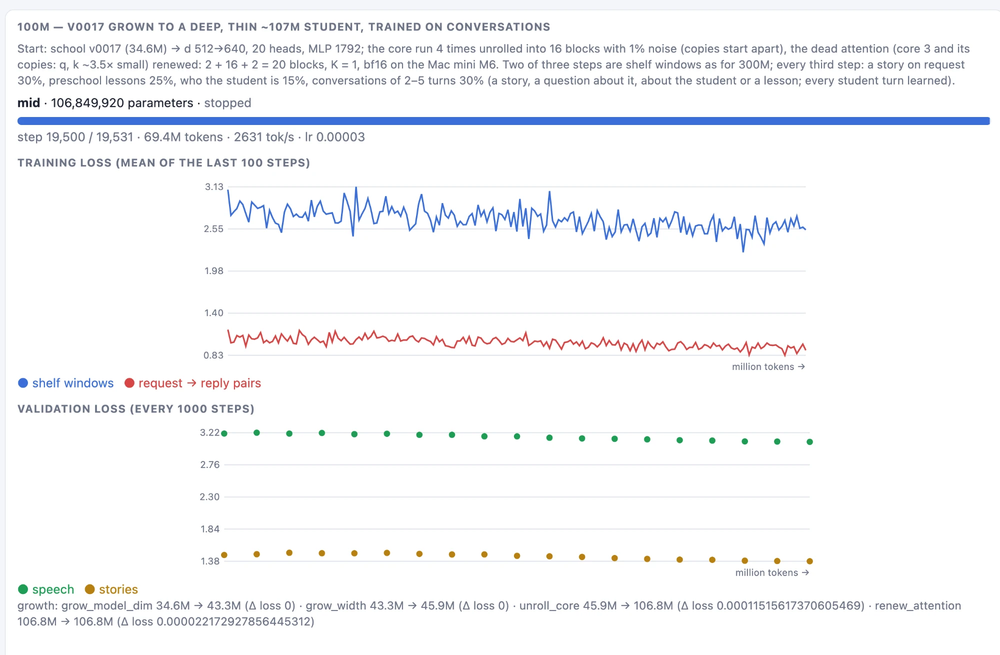
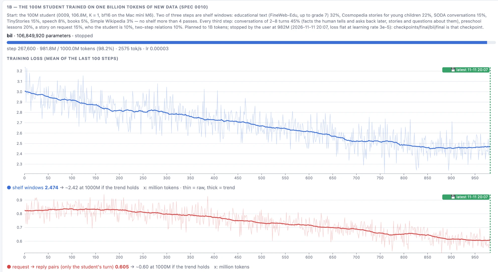
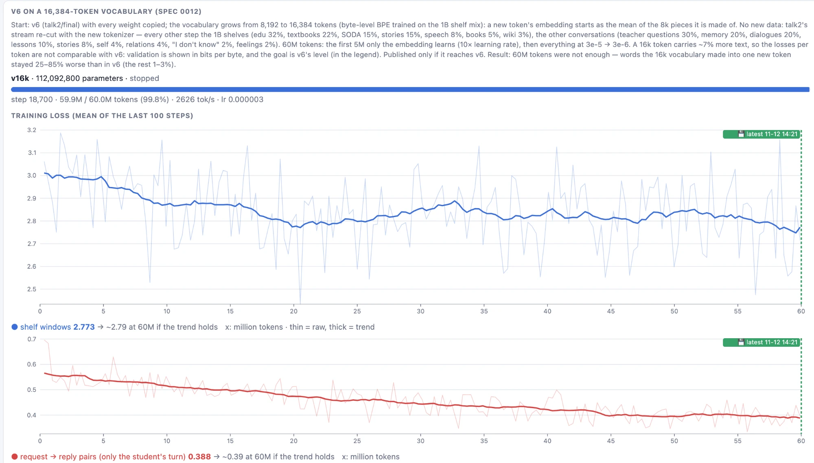

# Cerbeto

*Cerbeto* (Esperanto: *cerbo* "brain" + *-et-* diminutive) — "little brain".

A small neural network of our own, trained from random weights (6.9M → 34.6M parameters at school; the D student 106.8M). It learns English and reasoning like a child at school: nursery → preschool → grade 1 → grade 2. A local LLM teaches it in a day (lessons) / sleep (consolidation) / exam rhythm, and it grows while it learns.

## Methodology
**[Rondo](https://workwithrondo.com)** — **CDD (Context-Driven Development)**:
- README: the current state — domain, functional architecture, critical path;
- `specs/`: the intent of every change, in Rondo's nine sections (TL;DR, Abstract, Objective, Artefact Inventory, Functional Domain Changes, Critical Path, Control Gates, Expected Outcome, Additional Information);
- `CHANGELOG.md`: what was delivered, by date; the current state below is derived from it;
- tests: the proof, derived from each specification's control gates;
- [MANIFESTO.md](MANIFESTO.md): implementation principles for every specification.

## Current state (2026-11-13)
**Where we are:** the deep, thin D student (106.8M) **passed preschool** on 2026-11-07 (stage 1 of 3), read **one billion tokens** of textbooks, Wikipedia and conversations, and was tuned to answer questions: **v6** on Hugging Face answers 117 of 160 sampled chat questions (v5: 55) and remembers every name it is told. It now reads **a second billion**. The school student `v0017` (34.6M) is still in preschool.
- **Nursery done:** 300M tokens, 6.9M → 29.9M parameters, BLiMP 65.9%.
- **School running** (LLM teacher → sleep → exam, on a laptop, offline): preschool ~22% after the nursery → **60.5%** by day 7, flat on days 9–16, **68.5%** after day 18.
- **Plateau cause:** lessons were 97% right; the missing points were knowledge and question forms the lessons never gave.
- **Response (2026-11-05):**
  - harder days: weak skills more often, lessons mixing two skills, reading lessons that tell rare facts;
  - passing rule for moving between grades: mastery in every skill, transfer on average, no skill without transfer;
  - first growth in school: `v0016`, 34.6M, limit raised to 40M;
  - yes/no lessons think "claim → fact → decision" (the student knew the facts but answered "No. A dog says woof.").
- **Night bench (2026-11-06):** the night after day 17 replayed in 13 variants (learning rate, replay, consolidation, growth, thinking formats, core passes). None beyond chance (±3 pp from the seed alone); every night trades agree/disagree and categories for clarify, and the small validation set kept the start in most nights. Now a night keeps its end unless clearly worse, the exam decides, and earlier days are replayed once per prompt. Day 18 under these rules: **60.5% → 68.5%** (`v0017`) — rare opposites 25 → 85%, clarify 10 → 52%, agree/disagree 67 → 57% while its yes/no thinking changes.
- **Growth experiments (2026-11-06):** C — a wide 99M student, then a deep **283M** one on a new Mac mini M6 in bf16: no gain over `v0017` after 18M tokens (the unrolled blocks stayed copies, four with a dead attention). D — a deep, thin **~107M** student trained on conversations of several turns: after 69.4M tokens it **beats `v0017` on every measure** — conversation probe 2 → 8 of 10, stories on request 1.5 → 4.3 of 5, **preschool exam 68.5% → 76.3%, preschool passed** without a school night. Next: [0010](specs/0010-one-billion-tokens.md), 1B tokens with new data.
- **One billion tokens (2026-11-07 → 11-11):** [0010](specs/0010-one-billion-tokens.md) — D read textbooks, Wikipedia and conversations; every validation shelf fell, stopped at 982M when the loss was flat. Public since 2026-11-09 on Hugging Face as versions `v1`–`v5` with a chat in the browser. The chat did not grow with the tokens (v4 69, v5 55 of 160): the knowledge was there in "complete the sentence" form, not as answers — see [E](#e-one-billion-tokens--d-reads-textbooks-wikipedia-and-conversations-done).
- **Conversation tuning (2026-11-11 → 11-12):** [0011](specs/0011-conversation-tuning.md) — 50M tokens of questions with short answers (17,400 written by a local teacher), conversations that keep facts, "I don't know" about made-up words, every other step the 1B shelves. **v6-1032M:** chat 55 → 117 of 160, memory 19 → 40 of 40, nothing forgotten. At learning rate 1e-4 the first try forgot (shelf validation +0.2–0.3); 3e-5, where the 1B run ended, did not.
- **A larger vocabulary did not pay off yet (2026-11-12):** [0012](specs/0012-larger-vocabulary.md) — moving v6 to 16,384 tokens (text 7% shorter) or extending its 8k by 4,096 frequent merges (5% shorter) and training 60M tokens left it behind v6 in bits per byte; the loss sat in the new, rarer words — see [F](#f-a-larger-vocabulary--what-did-not-work).
- **A second billion tokens (since 2026-11-12):** [0014](specs/0014-second-billion.md) — from v6 on the 16k vocabulary, mostly text the first billion did not reach (a new shelf of grade 7–8 educational paragraphs, ~440M tokens); ends ~2026-11-17 — see [G](#g-a-second-billion-tokens-in-progress).
- **Next:** conversation tuning on the result → v7; then honest answers ([0013](specs/0013-honest-answers.md): answer what it knows, "I don't know" about the rest, instead of guessing).

**Specifications**

| Spec | Status |
|---|---|
| [0001](specs/0001-library-and-tokenizer.md) library and tokenizer | delivered; G5 (human review of shelf samples) pending |
| [0002](specs/0002-student-architecture-and-growth.md) student architecture and growth | delivered |
| [0003](specs/0003-nursery-stage-0-pretraining.md) nursery | delivered; control student dropped (2026-11-06) |
| [0004](specs/0004-curriculum-and-exams.md) curriculum and exams | delivered; passing rule changed 2026-11-05; G5 (human review of tasks) pending |
| [0005](specs/0005-school-day-sleep-exam.md) school: day, sleep, exam | **in progress** (preschool, second run, day 18); open: neuron renewal, self-correction format, brain API |
| [0006](specs/0006-rails-admin-panel-and-chat.md) admin panel and chat (Rails) | on hold: `cerbeto panel` and `cerbeto chat` are enough for now |
| [0007](specs/0007-offline-distribution.md) offline distribution | someday, maybe — not planned |
| [0008](specs/0008-growth-experiment-100m.md) growth experiment, 99M → 283M (C) | closed: no gain over `v0017` |
| [0009](specs/0009-deep-100m-conversations.md) deep 100M student with conversations (D) | closed: success, beats `v0017` on every measure; `/stats` analysis pending |
| [0010](specs/0010-one-billion-tokens.md) one billion tokens: new data for vocabulary, knowledge and conversations | done: stopped at 982M (2026-11-11), loss flat; public versions v1–v5 on Hugging Face |
| [0011](specs/0011-conversation-tuning.md) conversation tuning: answer the question, keep the facts | done: v6-1032M (2026-11-12), chat 55 → 117 of 160 |
| [0012](specs/0012-larger-vocabulary.md) a larger vocabulary, 8k → 16k | closed without a release: `v16k` and `vext` stayed behind v6 after 60M tokens; the 16k vocabulary goes on in 0014 |
| [0013](specs/0013-honest-answers.md) honest answers: "I don't know" instead of guessing | paused (2026-11-12): facts test written; waits for 0014 |
| [0014](specs/0014-second-billion.md) a second billion tokens | **in progress:** since 2026-11-12, ends ~11-17 |

<details>
<summary><b>Hypotheses</b></summary>

| Hypothesis | State | Evidence |
|---|---|---|
| A small model trained from scratch on child-level text learns grammar and short conversation | upheld | BLiMP 65.9%, conversation probe ([0003](specs/0003-nursery-stage-0-pretraining.md)) |
| Growth during the nursery keeps behaviour and saves compute | function preservation upheld (Δ loss ≈ 0 at every growth); saving compute not tested (control student dropped) | growth logs; [0002](specs/0002-student-architecture-and-growth.md) |
| A small local LLM is a reliable teacher when code verifies it | upheld | teacher exam: `gemma4:e4b-mlx` 97.5% correct, 94.8% consistent; unverified explanations never used |
| Day → sleep → exam raises school skills without forgetting the nursery | partly upheld: preschool 22% → 68.5%, nursery language kept; stage not passed | `runs/school/cycles.jsonl`, [0005](specs/0005-school-day-sleep-exam.md) §9 |
| Lessons in the training forms transfer to new forms and unseen items by themselves | refuted for this student | `id` high, `ood_hard` 10–57% on several skills; plateau days 9–16 |
| More parameters help the school plateau | open: on the bench the grown `v0016` behaves like `v0015` (new neurons unused); growth experiment C: wide 99M and deep 283M no better than `v0017` (283M after 18M tokens); **D: a deep, thin 107M with conversations beats it and passes preschool (76.3% vs 68.5%), the gain from data in the conversation format as much as from size** | [0005](specs/0005-school-day-sleep-exam.md) §9 |
| The settings of a school night decide its result | refuted on the bench: 13 variants, all within ±3 pp of a different seed | [0005](specs/0005-school-day-sleep-exam.md) §9, `runs/bench/` |
| Consolidation (EWC) holds what was learned | refuted as built: the nursery Fisher is almost zero; EWC on earlier lessons does not stop the trade between skills | [0005](specs/0005-school-day-sleep-exam.md) §9 |
| More passes of the recurrent core at answer time help | not seen in school: validation 75.1 / 76.5 / 75.3 / 73.9% at K = 2 / 4 / 6 / 8 | [0005](specs/0005-school-day-sleep-exam.md) §9 |

</details>

<details>
<summary><b>Setup and datasets</b></summary>

**Setup:** own BPE tokenizer (8192 tokens); teacher `gemma4:e4b-mlx` in local Ollama; nursery and school on a MacBook Pro M1 Pro, 32 GB (MPS, fp32); since 2026-11-06 the main machine is a Mac mini M6, 16 GB (MPS, bf16), the MacBook only develops code; library offline in `data/library/` (~4.8 GB), shelves in `data/shelves/`.

**Datasets** (built by the librarian of [0001](specs/0001-library-and-tokenizer.md))

| Shelf | Stage | Training tokens | Sources | Filter | Licence |
|---|---|---|---|---|---|
| `s0_speech` | 0 nursery | 83.6M | CHILDES (child = `<\|student\|>`, adults = `<\|human\|>`), Switchboard, BNC spoken, OpenSubtitles — via BabyLM-2026-Strict | dialogue, no reading-level filter | MIT (BabyLM) + upstream terms |
| `s0_stories` | 0 nursery | 544.5M | TinyStories V2 (GPT-4 stories in a 3–4-year-old's vocabulary) | none | CDLA-Sharing 1.0 |
| `s1_books` | 1 preschool | 37.3M | Project Gutenberg children's books (via BabyLM) | none | public domain |
| `s2_world` | 2 grade 1 | 0.8M | Simple English Wikipedia (2023-11 dump + BabyLM simple_wiki) | paragraphs up to grade 4 (FK ≤ 4): 99.6% rejected | CC BY-SA 4.0 |
| `s3_edu` | 3 grade 2 | 4.4M | FineWeb-Edu, one shard of the 10BT sample, edu score ≥ 3 | paragraphs up to grade 4: 99.5% rejected | ODC-By 1.0 |
| school lessons | 1–3 | generated | 16 task generators of [0004](specs/0004-curriculum-and-exams.md), rephrased and explained by the teacher | exam and validation prompts excluded | own |

</details>

<details>
<summary><b>What the student has seen</b></summary>

Training tokens by source (per school night: `runs/school/cycles.jsonl`, field `diet`).

| Phase | Tokens | By source | Result |
|---|---|---|---|
| A. Nursery (2026-10-31 → 11-01) | 300M | `s0_speech` 142.5M (1.7 passes), `s0_stories` 157.5M (0.29 passes) | BLiMP 65.9% |
| B. Preschool, school days 1–20 (2026-11-04 → 11-06) | 10.7M | today's lessons 2.4M, earlier days' lessons 2.5M, `s0_speech` 2.9M, `s0_stories` 2.9M | exam 22% → 68.5% (`v0017`) |
| C. Growth experiment (2026-11-06, stopped) | wide 99M: 4.8M; deep 283M: 18.3M | shelf windows two of three steps, request → reply pairs every third | no better than `v0017`; stories on request |
| D. ~100M with conversations (2026-11-06 → 07) | 69.4M | the same, a third of the pairs as conversations of 2–5 turns | better than `v0017` on every measure; preschool exam 76.3% |

Days 1–20 are estimated after the fact (hippocampus experiences × 141 night steps); from day 21 each night counts its tokens. Inputs only, padding excluded; lessons learn the student's turn only.

</details>

## A. Nursery — what the student can do
**Done 2026-11-01:** 300M tokens, 6.9M → 29.9M parameters, BLiMP 65.9%, conversation probe 80%. Language, but no knowledge or sense of truth yet.

<details>
<summary>Details</summary>

**Nursery exam** (`cerbeto exam nursery`, `checkpoints/growing/v0032`, 29.9M, 2026-11-01):

| Exam | Result | Gate | Note |
|---|---|---|---|
| BLiMP — grammar, minimal pairs (BabyLM filtered, 67 phenomena) | **65.9%** | ≥ 65% — passed | best: anaphor agreement, principle A, wh-vs-that without a gap (96–100%); below chance: long-distance dependencies, islands, NPI licensing (9–22%) |
| Conversation probe — 50 everyday situations graded by the teacher | **80%** fitting replies | ≥ 60% — passed | overrated: the teacher grades whether a reply fits, not whether it is true (*"Cats can fly, right?"* → *"yeah."* got 4/5); strictly, about half fit and are true — a baseline, not a blocking gate |

Details: [specs/0003](specs/0003-nursery-stage-0-pretraining.md) §9. In conversation with the same checkpoint: **language, but no knowledge or sense of truth yet.**

**Can do**
- **Tell stories** — its strongest skill. From *"Once upon a time, there was a little dog named Max."* it writes a paragraph with correct grammar, cause and effect (*"Max felt sad because…"*), dialogue and a new character. Over longer stretches it loses logic (*"a big, wet ball that looked like a ball"*), repeats and jumps between places.
- **Keep a short conversation on topic:**
  > Adult: Hi! What are you doing? — Child: I'm playing with the dolls. · Adult: Is it fun? — Child: yeah. I am. · Adult: Can I play too? — Child: yeah! I'm playing with the dolls. · Adult: What should we build? — Child: um we're making a castle. · Adult: Okay, bye bye! — Child: bye. we made a castle.

  Five turns on one topic; past tense once the play is over — untaught.
- **Polite routines:** greets, says goodbye, *"yes please"*, *"I'm sorry"*.
- **"Thinking longer" sometimes helps** (temperature 0): *"What does a cow say?"* → *"yeah."* at K = 1, *"moo."* at K = 2–8; *"The sky is green."* → repeated at K = 1, *"The sky is blue."* at K = 2–8, *"green"* again at K = 12 (beyond the trained K ≤ 6). Most of 15 probe questions do not change with K — a weak sign, not a measured effect.

**Cannot do yet**
- **Reliable facts:** *"What color is the grass?"* five times → yeah / yellow / green / yellow / green. The most likely answer is right for very common facts and *"I don't know."* for less common ones (*"What color is a banana?"*).
- **Tell true from false:** a *"yeah"* reflex on yes/no, also for false statements (*"Cats can fly, right?"* → *"yeah."*); occasional disagreement (*"The sky is green."* → *"is it blue?"*).
- **Give reasons:** form without content — *"Why?"* → *"'cause I'm thirsty."*
- **Know itself or count:** *"Who are you?"* → *"no."*; *"Can you count to five?"* → *"no."* (untaught).
- **Talk about a story:** writes stories, but *"What did the bear want?"* → *"I don't know."*

</details>

## B. Preschool — what the student can do
**`v0017`** (34.6M, day 18): preschool exam **68.5%**, not passed — strong on routines, facts and sizes; weak on yes/no and new combinations.

<details>
<summary>Details</summary>

**Last promoted version:** `checkpoints/school/v0017` (34.6M, day 18, 2026-11-06), preschool exam **68.5%** (after the nursery ~22%). **Not passed:** it needs mastery of every skill (`id`) and transfer (`ood`).

| Skill | `id` (as taught) | `ood_hard` (harder) | `ood_combo` (new combinations) |
|---|---|---|---|
| Polite routines | **97%** | 77% | 74% |
| Opinion with a reason (form only, checked by code) | 90% | 73% | 46% |
| Asking for clarification | **100%** | 52% | 45% |
| Agree / disagree | 57% | 56% | 57% |
| Facts (colours, body parts, animals) | **95%** | 57% | 69% |
| Opposites | **94%** | **85%** | 13% |
| Sizes (bigger / smaller) | **98%** | 69% | 50% |
| Categories (is X a Y?) | 66% | 74% | 53% |

Examples from the exam of `v0017` (prompts never seen in lessons); "thinks" is its `<|think|>` before the answer.

**Can do**
- **Polite routines:** *"You can have a candy."* → *"Thank you!"*; *"Grandma gives you an apple. What do you say?"* → *"Thank you!"*
- **Ask when a request is unclear:** *"There is a yellow bag and a blue bag. Can you bring me the bag?"* → *"Which one? The yellow bag or the blue…"*
- **Say "I don't know"** when the answer is not known: *"Anna has a dog. What is the name of Anna's dog?"* → *"I don't know."*
- **Taught facts and opposites:** *"Which part of your body helps you chew?"* → *"I chew with my teeth."*; *"Tell me the opposite of long."* → *"…short."*; also inside a story: *"Anna draws the sky. Which crayon does Anna need?"* → *"The crayon is blue."*
- **Compare sizes, also of three things:** *"Which is the biggest: a mouse, a dog or a cow?"* → *"A cow is the biggest."*
- **Opinion with a reason:** *"Do you like dogs?"* → *"Yes, I like dogs because they are soft."*
- **Think claim → fact → decision** before yes/no: *"Ducks can't swim. Right?"* → thinks *"Ducks can swim. So that is wrong"* → *"No."*

**Cannot do yet**
- **Decide yes/no reliably** — weakest skill. Right fact, wrong decision: *"A lemon is a fruit. Right?"* → thinks *"A lemon is a fruit. So that is wrong"* → *"No."*
- **Clarify in a new form:** with two coats → *"Here is the coat."*
- **Combine operations:** *"the opposite of the opposite of big"* → *"small"* (13%).
- **Keep the question's direction:** *"Which is smaller, a whale or a lion?"* → *"A whale is smaller."*; *"Your friend says thank you for the toy."* → *"Thank you!"*
- **Answer the question asked:** *"You hear with your ears. What do you clap with?"* → *"I hear with my ears."*
- **Rarer words:** *"the opposite of in"* → *"in"*; *"You clap with your what?"* → *"I clap with my clums."*

Details: `runs/school/exams/v0017.json`, [specs/0005](specs/0005-school-day-sleep-exam.md) §9.

</details>

## C. Growth experiment — from 100M to a deep 283M student
**Stopped 2026-11-06:** `v0017` grown to a wide 99M, then a deep 283M student; after 18.3M tokens no gain over `v0017` — the unrolled blocks stayed copies, four of them a dead attention.

<details>
<summary>Details</summary>

**Spec:** [0008](specs/0008-growth-experiment-100m.md). **Status:** stopped on 2026-11-06 at step 5,243 (18.3M tokens): no gain over `v0017`; replaced by **D** (`runs/final/deep/`, panel tab *C:100-300Mp fail*; checkpoint deleted 2026-11-07). Outside the school; its 40M limit stays.

**Question:** preschool sits at ~68% and no night setting moves it. Is the student short of **capacity** or of **data** (300M tokens, mostly stories, plus 10.7M in school)? Do request → reply pairs make it usable in a talk?

**From 100M to 300M:** the experiment started with `v0017` grown to a **wide 99M** student (width 896, still 8 blocks with the recurrent core). At learning rate 1e-3 it forgot within ~600 steps (speech validation loss 3.17 → 3.48); at 3e-4 it was stable but no better than `v0017` (step 1,000: speech 3.22, stories 1.47 vs 3.17 / 1.38). We stopped it at 4.8M tokens and changed the architecture: at this size deep-and-thin beats wide (MobileLLM, SmolLM; Qwen2.5-0.5B has 24 blocks at width 896), so the core is unrolled into separate blocks and the student grows to **~300M**. The planned same-size control arm was dropped: only the target size runs.

**Architecture: change from `v0017`**

| | `v0017` (preschool) | first: wide 99M (dropped) | **now: deep 283M** |
|---|---|---|---|
| parameters | 34.6M | 99.1M | **282.6M** |
| width (d) | 512 | 896 | **896** |
| heads | 16 × 32 | 28 × 32 | **28 × 32** |
| MLP | 1,792 | 3,072 | **3,072** |
| blocks: prelude + core + coda | 2 + 4 + 2 = 8 | 2 + 4 + 2 = 8 | **2 + 20 + 2 = 24** |
| core passes (K) | 1–6 in training, 4 at answer time | 1–6 / 4 | **none: K = 1** |
| effective depth | 20 at K = 4 | 20 | **24** |

The recurrent core is unrolled: its 4 blocks × K = 4 become 16 separate blocks with their own weights, plus 4 new blocks. After growth the student answers exactly like `v0017`. Vocabulary 8,192, context 512, embedding tied to the output. Activation checkpointing on.

**Stream, 80M tokens:** two of three steps are shelf windows (stories 40%, speech 30%, books 18%, edu 9%, Wikipedia 3%; every token learned); every third step is request → reply pairs (story on request 55%, preschool lessons 40% — never an exam prompt, who the student is 5%; student's turn learned). Learning rate 3e-4, warm-up 300 steps, cosine to 10%.

**What 80M shows from each shelf:**

| Shelf | Has | Will see | Passes |
|---|---|---|---|
| stories (`s0_stories`) | 544M | ~21M | 0.04× |
| speech (`s0_speech`) | 83M | ~16M | 0.2× |
| books (`s1_books`) | 37M | ~10M | 0.3× |
| education (`s3_edu`) | 4.4M | ~5M | 1.1× |
| Wikipedia (`s2_world`) | 0.8M | ~1.6M | 2× |

The rest are request → reply pairs. Seeing all 670M once needs a ~10× longer run.

**New hardware: Mac mini M6, 16 GB, bf16**
- Started on the MacBook (M1 Pro, fp32, ~810 tokens/s); moved at step 2,963 to a **Mac mini M6** (16 GB), now the main machine: data, checkpoints, runs, training and the panel live there (the code arrives with `git push`: the Mac mini checkout is a second push target of `origin`, next to GitHub). Training resumes from the last save (weights, optimizer, step).
- **bf16 mixed precision** (from step 3,171): forward and backward in bfloat16, weights and the optimizer stay fp32 — the checkpoint is not converted. The M1 has no native bf16; the M6 does. `--fp32` turns it off.

| Machine | Precision | Tokens/s | 80M tokens |
|---|---|---|---|
| MacBook Pro M1 Pro, 32 GB | fp32 | ~810 | ~27 h |
| Mac mini M6, 16 GB | fp32 | ~950 | ~23 h |
| **Mac mini M6, 16 GB** | **bf16** | **~1,390** | **~16 h** |

16 GB is tight for 283M with AdamW (~4.5 GB of weights, gradients and optimizer state plus activations): ~1.4 GB of swap, stable.

**Validation loss (lower is better):**

| Step (tokens) | speech | stories |
|---|---|---|
| `v0017` | 3.17 | 1.38 |
| 1,000 (3.5M) | 3.23 | 1.50 |
| 2,000 (7.0M) | 3.23 | 1.50 |
| 3,000 (10.4M) | 3.20 | 1.51 |
| 4,000 (13.9M) | 3.20 | 1.50 |

**Reading the result**
- **80M is little for 283M parameters:** the Chinchilla rule of thumb is ~20 tokens per parameter (~5.7B); 80M is ~1.4%. No gain at 80M does **not** show that size does not help.
- **More data, before any crawling:** more FineWeb-Edu shards (one gave 4.4M tokens at grade ≤ 4, there are hundreds); a reading-level limit rising with each passed grade; synthetic child-level textbooks (Cosmopedia *young children*, or texts by the local teacher for the curriculum). Every new shelf passes the same filters and the exam leak check. Repeating a shelf helps up to ~4 passes.

**Result: no improvement.** After 18M tokens the 283M student was no better than `v0017`:
- **Validation flat** for 4,000 steps and still slightly worse than `v0017` (speech 3.20 vs 3.17, stories 1.50 vs 1.38); the loss on request → reply pairs flat at ~1.25 from step 100.
- **One new skill, from the data, not the size:** asked for a story it tells one (`v0017`: "Thank you!"). But after a story it goes on with it when asked "who are you?", and its facts got worse ("what color is the sky?" → "blue. The blue bird was red…"): it never saw more than one turn.
- **The new capacity was not used** (`cerbeto chat /stats`, weight norms): the 16 unrolled core blocks were still copies of `v0017`'s four (weight norms equal to 0.5%), and four of them a **dead attention** — core 3 of `v0017` has q and k ~3.5× smaller than the other blocks and spreads its attention evenly over every token (spread 1.00), copied four times. Only 3 of 672 heads pointed at one token, none at "sky" or "color": the answer comes from memory in the MLPs, not from reading the question.
- **Too slow for the data we have:** ~1,390 tokens/s on the M6; 80M tokens is ~1.4% of the ~20 tokens per parameter rule of thumb.

</details>

## D. A deep, thin ~100M student that learns conversations
**Spec:** [0009](specs/0009-deep-100m-conversations.md). **Status:** closed 2026-11-07, success (`python -m cerbeto.train.final_test train mid`, panel tab *D:80Mt run*, `runs/final/mid/`, `checkpoints/final/mid/`).

**Question:** with the lessons of C — smaller and faster, copies that start apart, no dead attention, and conversations of several turns — does the student learn to keep turns apart and use what was said?

**Architecture: the same idea as C, a different shape**

| | `v0017` | C (283M, stopped) | **D (~107M)** |
|---|---|---|---|
| width (d) | 512 | 896 | **640** |
| heads | 16 × 32 | 28 × 32 | **20 × 32** |
| MLP | 1,792 | 3,072 | **1,792** |
| blocks | 2 + 4 (K = 4) + 2 | 2 + 20 + 2 | **2 + 16 + 2 = 20** |
| core passes (K) | 1–6 / 4 | 1 | **1** |

Deep and thin like MobileLLM-125M; ~2.7× faster than C, so a night shows several times more tokens per parameter.

**What changes from C**
- **Copies start apart:** the core run 4 times is unrolled into 16 blocks, each copy after the first with 1% Gaussian noise on its weights (within the Δ loss guard).
- **Dead attention renewed:** in every copy of `v0017`'s core 3, q, k and v start fresh and the output o at zero, so the block learns to attend instead of averaging.
- **Conversations:** a third of the request → reply steps are conversations of 2–5 turns that change the subject — a story, a question about it ("What was the dog's name?" → "The dog's name was Max."), who the student is, a lesson — every student turn learned, no human turn. The rest: a story on request 30%, preschool lessons 25%, who the student is 15% (18 questions instead of 8).
- **One turn format** in training and in the chat (`cerbeto chat --memory`): `<|human|> …\n<|student|><|answer|> …<|eos|>` per turn.
- **A conversation probe** in the evaluation: 10 held-out conversations (a story, then "Do you remember the cat's name?"; a story, then "Who are you?"; a fact after a story …).

**Training result — the first real long-run gain.** The full run finished on 2026-11-07 at 05:00: 19,531 steps, **69.4M tokens** (the step count was planned for 80M; the request → reply steps carry fewer tokens than shelf windows), ~2,630 tokens/s, ~7.3 h on the M6.



| Step (tokens) | speech | stories |
|---|---|---|
| `v0017` | 3.17 | 1.38 |
| C, 283M, step 4,000 (13.9M) | 3.20 | 1.50 |
| 1,000 (3.6M) | 3.21 | 1.47 |
| 5,000 (17.8M) | 3.20 | 1.49 |
| 10,000 (35.5M) | 3.17 | 1.46 |
| 15,000 (53.3M) | 3.11 | 1.40 |
| **19,000 (67.5M)** | **3.09** | **1.38** |

- **Speech better than `v0017`** (3.09 vs 3.17) — the first growth that beats the school's best version; C never did.
- **Stories back to `v0017`'s level:** after growth and the new data mix they rose to ~1.50 and needed the whole run to come back.
- **Still falling at the end**, with the learning rate already at its minimum: the student is not saturated; 69M tokens is ~3% of ~20 tokens per parameter. More data should help.
- **Request → reply pairs:** loss down from ~1.1 to ~0.9 (C stayed flat at ~1.25).

**Evaluation — `mid` beats `v0017` on every measure** (2026-11-07, same settings, M6, teacher `gemma4:e4b-mlx`; `runs/final/eval_*.json`):

| Measure | `v0017` (34.6M) | **D (106.8M)** |
|---|---|---|
| validation loss: speech / stories | 3.17 / 1.38 | **3.09** / 1.38 |
| conversation probe (10 held-out conversations) | 2 / 10 | **8 / 10** |
| stories on request (teacher's grade 1–5) | 1.5 | **4.3** (90% graded ≥ 4) |
| nursery conversation probe | 84% | **88%** |
| **preschool exam** | 68.5% | **76.3%** |
| **preschool passed** (rule of [0004](specs/0004-curriculum-and-exams.md)) | no | **yes** |

**Preschool passed.** The rule for moving to the next grade: every code-graded skill ≥ 85% `id`, mean `ood_hard` ≥ 70%, no skill below 50% `ood_hard`. D: `id` 89.7–100% in all seven code-graded skills, mean `ood_hard` **78.5%**, lowest `ood_hard` **50.0%** (facts — exactly at the floor). `v0017` failed it on agree/disagree (57% `id`). The rule does not count new combinations (`ood_combo`), where D is weak (opposites 0%, agree/disagree 42%) — see *Cannot do yet*.

**Can do now**
- **Keep turns apart:** "Tell me a story." → a story; "Who are you?" → *"I'm Cerbeto. I'm a little student, and I'm learning to talk."* (`v0017` and C went on with the story).
- **Use an earlier turn:** a story about a bear named Ben, then "Is a cat an animal?", then "What was the bear's name?" → *"The bear's name was Ben."*
- **Tell stories on request** (`v0017`: *"Thank you!"*), and know itself: "Are you a bird?" → *"No, I'm not a bird. I'm a little student."*
- **Preschool +7.8 pp without a school night** — more than days 9–18 of school gave `v0017`: categories 66 → 100% and agree/disagree 57 → 90% as taught, opinion with a reason 90% in new combinations (was 46%).

**Cannot do yet**
- **Compose:** new combinations of facts and opposites fell (51% and 0%) — knowledge is memorised, not combined.
- **Resist a leading question:** a story about a fox named Red, then "Was the story about a dog?" → *"Yes, it was about a dog named Red."*
- **Unseen phrasings:** "Do you remember the cat's name?" → *"No, I do not remember the cat's name."*

**Reading the result:** the conversation format gave the turns, the self and the stories; the size and depth carried them without forgetting. Validation was still falling at ~0.6 tokens per parameter, so data is the limit now → [0010](specs/0010-one-billion-tokens.md): 1B tokens with new data for vocabulary, knowledge and conversations. Details: [0009](specs/0009-deep-100m-conversations.md) §9.

## E. One billion tokens — D reads textbooks, Wikipedia and conversations (done)
[0010](specs/0010-one-billion-tokens.md): the D student (106.8M, unchanged) trained on 1B new tokens on the Mac mini M6, bf16, batch 8 × 512, ~2,570 tokens/s, cosine learning rate; started 2026-11-07, stopped by the user at 982M on 2026-11-11 20:07 (learning rate 3e-5, validation moving by thousandths). Before the run D had read 391M tokens (nursery 300M, preschool 11M, conversations 80M).



**Validation loss** (`runs/final/bil/log.jsonl`, lower is better):

| Tokens of the run | edu | textbooks | dialogue | stories | speech |
|---|---|---|---|---|---|
| 4M (start) | 4.031 | 3.037 | 2.369 | 1.576 | 3.253 |
| 110M | 3.732 | 2.631 | 1.862 | 1.665 | 3.312 |
| 220M | 3.650 | 2.553 | 1.812 | 1.640 | 3.275 |
| 330M | 3.572 | 2.462 | 1.736 | 1.591 | 3.257 |
| 440M (≈ v1) | 3.527 | 2.421 | 1.670 | 1.566 | 3.209 |
| 473M (≈ v2) | 3.507 | 2.384 | 1.656 | 1.550 | 3.203 |
| 525M (≈ v3) | 3.476 | 2.367 | 1.624 | 1.516 | 3.194 |
| 554M (≈ v4) | 3.449 | 2.349 | 1.617 | 1.502 | 3.170 |
| 982M (end, `bil/final`) | 3.243 | 2.149 | 1.408 | 1.336 | 3.021 |

Every shelf fell to the end; textbooks and dialogue gained most (−0.89 and −0.96 from the start). Stories and speech first rose (new shelves pushed them aside), then fell below the start after ~370–400M. Wikipedia was read once by ~555M; from there it repeats.

**Published versions** on Hugging Face — model <https://huggingface.co/michalasobczak/cerbeto> (tag per version), chat in the browser <https://huggingface.co/spaces/michalasobczak/cerbeto-chat> (ONNX int8, ~110 MB, transformers.js); publishing: [scripts/hf/README.md](scripts/hf/README.md):

| Version | Tokens of the run | Tokens in all | Published | Note |
|---|---|---|---|---|
| `v1-439M` | 439M | 830M | 2026-11-09 | first public model (tagged `bil-439M`) |
| `v2-472M` | 472M | 863M | 2026-11-09 | (tagged `bil-472M`) |
| `v3-523M` | 523M | 914M | 2026-11-09 | |
| `v4-555M` | 555M | 946M | 2026-11-09 | chat better than v3 (below) |
| `v5-704M` | 704M | 1,095M | 2026-11-10 | published on request although the chat is weaker than v4: completing 26 → 35, chat 69 → 55, memory 23 → 19 (below) |
| **`v6-1032M`** | **982M + 50M tuning** | **1,423M** | 2026-11-12 | conversation tuning (spec 0011, `talk2`): chat 55 → 117, completing 35 → 38, memory 19 → 40 (below) |

**Chat spot check, v3 → v4** (2026-11-09, each question asked 10 times at temperature 0.7, K = 1, answers checked by a pattern; v4 measured at 551M):

| Part | v3 (523M) | **v4 (551M)** |
|---|---|---|
| **chat: 16 questions** | 47 / 160 | **65 / 160** |
| completing a sentence: 8 | 23 / 80 | 22 / 80 |
| memory: 4 conversations of 3 turns | 20 / 40 | 19 / 40 |

<details>
<summary>Per question</summary>

| Question (correct if) | v3 | v4 |
|---|---|---|
| Is fire hot? (yes) | 3 | 1 |
| Is the sun hot? (yes) | 0 | 0 |
| Is ice cold? (yes) | 2 | 1 |
| Is snow cold? (yes) | 1 | 0 |
| The sky is green. Is that right? (no) | 10 | 10 |
| **A cat can fly. True or false?** (no / false) | 0 | **9** |
| **A fish can swim. True or false?** (yes / true) | 0 | **8** |
| Is a dog an animal? (yes) | 10 | 10 |
| Is a carrot a fruit or a vegetable? (vegetable) | 0 | 0 |
| **Where do fish live?** (water, sea, pond …) | 1 | **6** |
| What do bees make? (honey) | 0 | 0 |
| How many legs does a bird have? (two) | 0 | 0 |
| What color is grass? (green) | 10 | 10 |
| What is the capital of France? (Paris) | 0 | 0 |
| What do cows give us? (milk) | 0 | 0 |
| What is the opposite of hot? (cold) | 10 | 10 |
| … Water freezes and turns into (ice) | 1 | 1 |
| … The Moon goes around the (Earth) | 8 | 4 |
| … The capital of France is (Paris) | 0 | 0 |
| … Bees make (honey) | 0 | 2 |
| … The heart pumps (blood) | 5 | 9 |
| … Plants need sunlight and (water) | 9 | 6 |
| … A baby cat is called a (kitten) | 0 | 0 |
| … The largest planet in our solar system is (Jupiter) | 0 | 0 |
| memory: name, then *a cat called Tom* → cat's name | 0 | 0 |
| memory: name, then *a horse called Sunny* → horse's name | 0 | 0 |
| memory: *I am Zoe*, *my bird is called Kiwi* → bird's name | 10 | 9 |
| memory: name, then *a dog called Rex* → my name | 10 | 10 |

</details>

**Spot check v4 → 640M (2026-11-10, not published):** chat 69 → 52 of 160, completing 26 → 25 of 80, memory 23 → 10 of 40. The 640M checkpoint lost "A cat can fly. True or false?" (10 → 0), "Where do fish live?" (9 → 0) and the pet names (bird 9 → 0), although every validation loss was lower. The same v4 scored 65 and 69 of 160 on two days: the sampling noise is about ±5, these drops are not. Validation loss does not measure the chat; a version is published only when the spot check is better.

**Spot check v4 → 687M (2026-11-10, not published):** chat 69 → 60, completing 26 → 29, memory 23 → 12. "A cat can fly" is back (10 → 10), "Where do fish live?" (9 → 1), "A fish can swim" (6 → 1) and the pet names (bird 9 → 2, horse 4 → 0) are still lost.

**Spot check v4 → v5-704M (2026-11-10, the published v5):** chat 69 → 55 of 160, completing 26 → 35 of 80, memory 23 → 19 of 40. v5 knows more facts when it completes a sentence ("The heart pumps" 7 → 10, "Bees make" 0 → 3, "Water freezes and turns into" 2 → 4) and remembers the bird again (Kiwi 9 → 9), but lost "Where do fish live?" (9 → 0), "A fish can swim" (6 → 0) and the horse (4 → 0). Published on request, against the rule above.

**Spot check v5 → 783M (2026-11-10 evening, not published):** chat 55 → 54 of 160, completing 35 → 25 of 80, memory 19 → 18 of 40. "A fish can swim" came back (0 → 5), "Plants need sunlight and" fell (8 → 2); "Where do fish live?" and the horse stay at 0. Within the noise for chat and memory, worse at completing: the chat does not grow with the tokens in this mix (69 → 52 → 60 → 55 → 54 since v4).

**Spot check v5 → 982M, the end of the 1B run (2026-11-11 evening, not published):** the run was stopped by the user at 982M tokens (learning rate 3e-5, shelf loss flat at ~2.45, validation moving by thousandths); `bil/final` is that checkpoint. Chat 55 → 62 of 160, completing 35 → 33 of 80, memory 19 → 13 of 40. "A fish can swim" 0 → 10, "Where do fish live?" 0 → 3, but "A cat can fly" 10 → 3 and the bird Kiwi 9 → 3. Chat a little above the noise, memory worse: not published. Conversation tuning (spec 0011, arm `talk`, 50M tokens) started from it at 20:08.

**Conversation tuning, spot check (2026-11-12 early morning, `talk2` published as v6):** two runs from 982M on the same data (spec 0011). `talk` at learning rate 1e-4 lifted shelf validation by 0.2–0.3 and was stopped at 25M; `talk2` at 3e-5 with every other step on the shelves ran the full 50M, and its shelf validation ended slightly *below* 982M (edu 3.243 → 3.242, textbooks 2.149 → 2.132, dialogue 1.408 → 1.386). Against v5 (55/35/19): `talk` chat 116 of 160, completing 40 of 80, memory 40 of 40; `talk2` chat 117, completing 38, memory 40. Both pass G3 by far: "Where do fish live?" 0 → 10, a carrot is a vegetable 0 → 10, all four pets remembered 10 of 10. Still wrong in both: the capital of France, "A baby cat is called a", the largest planet. `talk2` is published as **v6-1032M** (same scores, no forgetting).

**Can do now (v4)**
- **Think before a true/false answer**, also in the new form "… True or false?": *"A cat can fly. True or false?"* → 💭 *"A cat cannot fly. So that is wrong, and the answer is no."* → *"No. A cat cannot fly."*
- **Hold a short conversation:** greets by name, remembers the name and a pet named in its own sentence.
- **Tell stories** that differ from each other (v3 told the cat and the dog the same story about an apple).

**Cannot do yet**
- **Answer world questions it can complete:** "The heart pumps …" → *blood*, but most "What …?" questions get a preschool pattern (*"A bee says buzz"*). The knowledge is there; the question-and-answer form is missing.
- **Recall the right fact while thinking:** "Is the sun hot?" → 💭 *"The sun is yellow. So that is wrong"* → *"No."*
- **Keep two names apart:** a cat or a horse gets the human's name.
- **Empathy and "I don't know":** "I feel sad today." → *"That's nice!"*; "What is a zorblat?" → *"A zorblat is a fruit."*

## F. A larger vocabulary — what did not work
[0012](specs/0012-larger-vocabulary.md): the 8,192-token vocabulary (chosen for the nursery) is the smallest among models of this size, so after v6 we tried a larger one **on the trained model**. Text measured in bytes per token on each shelf's validation text: 16,384 tokens make the 1B mix **7.1% shorter** (edu 9.7%, textbooks 10.0%); words such as *photosynthesis* (6 pieces) or *Jupiter* (3) become one token. Models with different vocabularies are compared in **bits per byte** (lower is better).

- **`v16k`:** a new 16k byte-level BPE; every weight copied from v6, each new token's embedding the mean of its 8k pieces; 60M tokens of v6's tuning stream (5M only the embedding, then everything at 3e-5).
- **`vext`:** the 8k vocabulary *kept* (same tokens, ids and rows), only its 4,096 most frequent new merges added (12,288 tokens, 5.2% shorter, the rarest new token seen 308 times in 200 MB); the new rows learn 10× faster.



| bits per byte | v6 | `v16k` (60M) | `vext` (58M) |
|---|---|---|---|
| edu | **1.246** | 1.360 | 1.300 |
| textbooks | **0.742** | 0.814 | 0.784 |
| dialogue | **0.496** | 0.521 | 0.504 |
| stories | **0.469** | 0.485 | 0.473 |
| speech | **1.245** | 1.256 | 1.273 |

**Where `v16k` loses** (`cerbeto.tokenizer.vocab where`: both tokenizers cut text at the same word boundaries, so each word's loss can be compared exactly): on words both vocabularies cut the same, `v16k` is 1–3% worse than v6; on words the 16k vocabulary made into one new token, **25–85% worse** (edu 1.42 → 1.84 bits per byte) — ~80% of the gap. The network kept what it knew; the new words were too rare to learn in 60M tokens. Keeping the old tokens and adding fewer, more frequent ones (`vext`) roughly halved the gap on edu and textbooks but did not close it.

**Reading the result:** a new vocabulary on a trained model is new knowledge, not a format change — it pays off with a long training, not a short tuning. The 16k vocabulary therefore goes on in the second billion ([G](#g-a-second-billion-tokens-in-progress)), where its words get hundreds of millions of tokens.

## G. A second billion tokens (in progress)
[0014](specs/0014-second-billion.md): v6 has read ~10 tokens per parameter (SmolLM-135M read 600B), and the first billion did not reach most of its own library — edu ~40%, stories ~20%, dialogue ~45%. A new shelf adds the FineWeb-Edu paragraphs of grade 7–8 from the shards already on disk (`s3_edu_8`, ~440M tokens; edu had grade ≤ 7), apart from edu's paragraphs and its validation.

- **Start:** `v16k/final` (v6 on the 16k vocabulary); 1B tokens on the M6, ~2,550 tokens/s, ends ~2026-11-17.
- **Stream:** three of four steps shelves (edu 8 30%, edu 22%, textbooks 12%, dialogue 12%, stories 10%, speech 6%, books 5%, wiki 3%), the fourth v6's conversations so it keeps answering.
- **Learning rate** warmed up again to 1e-4 over 1,000 steps, cosine to 1e-5.

**So far (88M, 2026-11-13):** edu falls (1.360 → 1.331 bits per byte); the warm restart lifted stories and dialogue by ~0.05 within 10M tokens, flat since — as in the first billion, where stories and speech first rose and fell below the start after ~370–400M. Checked again at ~300M. Afterwards: conversation tuning as v6, the spot check, and v7 if it is better.

## Next phases and their expected effects
<details>
<summary>Details</summary>

| Phase | What happens | Expected effect | How we will know |
|---|---|---|---|
| **0005 — school** | **day:** lessons with the local LLM teacher, experiences in the hippocampus; **sleep:** consolidation with replay, EWC, neuron renewal; **exam:** promotion, rollback or growth | answers follow the truth instead of *"yeah"*; *"I don't know"* only when unknown; stable facts; then reading, counting, simple reasoning — grade by grade, without forgetting | **MVP priority:** `ood_hard` + `ood_combo` ≥ +20 pp vs baseline; `id` ≥ 85% per grade; forgetting ≤ 2 pp |
| **0006 — admin panel** (on hold) | Rails panel: teachers, live lessons, progress, brain, versions, library, chat | a human watches, talks to and corrects the student | every function within 2 clicks; live view ≤ 2 s |
| **0007 — offline distribution** (someday, maybe) | package: student, curriculum, local teacher, learning tool, panel | the student keeps learning at people's homes on a 16 GB Mac, offline; every copy a separate child | clean 16 GB Mac: install ≤ 30 min, 3 offline cycles, peak RAM ≤ 14 GB |

</details>

## Domain
<details>
<summary>Details</summary>

| Term | Meaning |
|---|---|
| Student | our own network (transformer with a recurrent core), grows from 6.9M up to the 40M limit |
| Teacher | LLM in local Ollama: homeroom teacher, tutor or assistant examiner |
| Library / shelves | text corpora by difficulty (stages 0–3) |
| Lesson | a task from a generator (truth from code) + a dialogue with the teacher |
| Hippocampus | fast memory of the day's experiences (SQLite) |
| Sleep | experiences into weights + replay + consolidation (EWC) + neuron renewal |
| Exam | grading by code: `id`, `ood_hard`, `ood_combo`; forgetting gate ≤ 2 pp |
| Version | immutable student state after every weight change; promotion or rollback |

</details>

## Functional architecture
<details>
<summary>Details</summary>

```
                 ┌──────── panel/ (Rails 8, :3100) — on hold, 0006 ─────────┐
                 │ teachers · live school · progress · brain · versions ·   │
                 │ library · chat (a human can correct the student)         │
                 └───────────────────────┬──────────────────────────────────┘
                                         │ HTTP (specs/contracts/brain-api.yaml)
┌──────────────────────────── brain/ (Python + PyTorch, :8700) ──────────────────────────┐
│ library/tokenizer ─▶ model (student, growth, EWC) ◀─ school: day ─▶ sleep ─▶ exam       │
│                         ▲                          │   ▲                │              │
│                     versions ◀─────────────────────┘   │ hippocampus    curriculum +   │
│                                                        │ (SQLite)       exams (code)   │
└────────────────────────────────────────────────────────┼───────────────────────────────┘
                                                         │ OpenAI-compatible
                                                 Ollama (teacher, local)
```

</details>

## MVP critical path
0001 library and tokenizer → 0002 student → 0003 nursery + baseline → 0004 curriculum and exams → 0005 school (MVP priority: `ood` improvement after learning cycles) → 0006 admin panel (on hold) → 0007 offline distribution (someday, maybe).

## Repository layout
<details>
<summary>Details</summary>

```
README.md  MANIFESTO.md  CHANGELOG.md
specs/            change specifications (NNNN-slug.md) + source document and contracts
scripts/          library download, packaging; hf/ publishing to Hugging Face
brain/            brain — Python package `cerbeto`
panel/            admin panel — Rails (on hold, 0006)
config/           library, curriculum, architecture, rhythm, teachers
data/ runs/ checkpoints/   outside git
```

</details>

## Getting started
<details>
<summary>Details</summary>

Download the library (resumable, ~5 GB):
```bash
./scripts/download_library.sh
```
Build shelves, train the tokenizer, tokenize, check the gates (from `brain/`):
```bash
uv run cerbeto library build && uv run cerbeto tokenizer train && uv run cerbeto library tokenize && uv run cerbeto library report
```
Tests (`-m slow` for the GPU memory gate):
```bash
uv run pytest
```
Nursery (resumable — re-run after an interruption) and its exam:
```bash
uv run cerbeto nursery run --student growing
```
```bash
uv run cerbeto exam nursery --student growing
```
Live training dashboard (progress, ETA, validation loss, growth, latest exam, RAM, GPU, power); read-only; `--interval 2`, `--once`:
```bash
uv run cerbeto top
```
Talk to the student (latest checkpoint; `--student school`, `--version v0032`, `--k`, `--temperature`, `--device cpu` to keep the GPU free):
```bash
uv run cerbeto chat
```
In the chat, plain text is a conversation; commands probe one skill:

| Command | What it checks |
|---|---|
| `/story Once upon a time, a little cat…` | storytelling |
| `/ask 5 What color is the grass?` | stability: the same question five times |
| `/think The sky is green.` | the most likely answer at K = 1, 2, 4, 8 |
| `/k 8`, `/temp 0` | passes of the recurrent core; temperature (0 = most likely answer) |
| `/reset`, `/info`, `/help`, `/quit` | forget the conversation, show the checkpoint, help, leave |
| ←/→, ↑/↓ | edit the line; history (`runs/chat_history`) |

One-shot:
```bash
uv run cerbeto chat --say "Hello!" --say "Are you happy?"
```
School exams (0004): build the frozen pools, check lessons never repeat an exam prompt, examine a student (`--limit 20` for a quick look):
```bash
uv run cerbeto exam build && uv run cerbeto exam check-leak
```
```bash
uv run cerbeto exam run --student growing
```
Smoke check: 30 minutes of direct preschool lessons (separate student in `checkpoints/smoke/`), then the exams:
```bash
uv run cerbeto school smoke --stage preschool --minutes 30
```
Teacher admission exam (solves and explains tasks of every stage, graded by code):
```bash
uv run cerbeto teacher exam --per-skill 50
```
School (0005): day → sleep → exam → promotion or rollback, preschool → grade 2, on a copy of the nursery student in `checkpoints/school/`. Ctrl+C is safe; the same command resumes:
```bash
uv run cerbeto school run
uv run cerbeto school status
```
School panel (status, ETA, exams, days, lessons with the teacher's explanations, bench, log, machine) at http://127.0.0.1:8765, read-only:
```bash
uv run cerbeto panel
```
Smoke-train a fresh student for 30 minutes:
```bash
uv run cerbeto train --smoke --minutes 30
```

</details>

## Related work
None of Cerbeto's building blocks is new; the combination seems to be. A short literature check (November 2026, not systematic; several 2026 items are preprints known from their abstracts):

<details>
<summary>Details</summary>

| Work | Shared with Cerbeto | Different |
|---|---|---|
| [CurLL](https://arxiv.org/abs/2510.13008) (BabyLM 2025) | developmental stages, skill graph, continual learning, forgetting and transfer, a 135M model | 23.4B tokens of pre-generated LLM data; no teacher in the loop, no day/night, no exam gates, no growth |
| [LittleLearner](https://arxiv.org/abs/2608.13545) (2026) | trained from scratch on school (K–5) material only | 0.6–5B parameters, 88B tokens of plain pretraining; studies the knowledge boundary, not the learning process |
| [BabyLM interaction track](https://aclanthology.org/2025.babylm-main.28/), [ContingentChat](https://aclanthology.org/2025.babylm-main.25/) (2025) | a small student learns from a large LLM teacher in rounds | no code verification, no sleep, no growth, mostly one stage |
| [Language Models Need Sleep](https://arxiv.org/abs/2606.03979) (2026) | sleep as memory consolidation | large pretrained models, dreaming through RL; no curriculum or exams |
| [Wake-Sleep Consolidated Learning](https://arxiv.org/abs/2401.08623) (NeurIPS 2024) | wake/sleep, short-term memory replayed at night | vision classification |
| [From Growing to Looping](https://arxiv.org/abs/2602.16490) (2026) | growth together with a looped block | large-scale pretraining, no curriculum or teacher |
| [Huginn / recurrent depth](https://arxiv.org/abs/2502.05171) (2025), [retrofitted recurrence](https://arxiv.org/abs/2511.07384) | prelude → recurrent core → coda, "think longer" with the same weights | 3.5B parameters, 800B tokens; no curriculum, no growth |
| [Toddler-level model](https://aclanthology.org/2025.sigdial-1.30.pdf) (SIGDIAL 2025), [BabyLM curricula](https://aclanthology.org/2025.babylm-main.36.pdf) | a small model speaking like a young child, staged child-directed data | pretraining only, no school |

Not found elsewhere: one small model, grown from scratch, going to school in a day → sleep → exam loop with an LLM teacher whose explanations code verifies, with promotion and rollback of versions — on a laptop, offline. Closest architecture: Huginn; unlike it, Cerbeto also thinks in text (`<|think|>`) and grows while learning. Its blocks are Llama/Qwen's (RoPE, SwiGLU, RMSNorm).

</details>

## License
Cerbeto — concept, specifications and code — © 2026 Michał Sobczak.

**[PolyForm Noncommercial License 1.0.0](LICENSE.md)**: read, run, modify, fork and share for any **noncommercial** purpose (personal, research, education, hobby), keeping the copyright notice. **Commercial use requires the author's written permission** — contact via [GitHub](https://github.com/michalasobczak).

The school library is not in this repository; its corpora keep their own licences (BabyLM — MIT, TinyStories — CDLA-Sharing-1.0, Wikipedia — CC BY-SA 4.0, FineWeb-Edu — ODC-By 1.0), recorded in each shelf's `manifest.json`.
